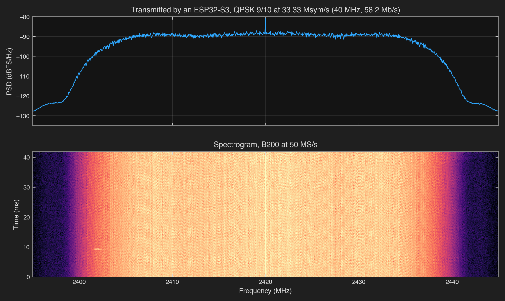
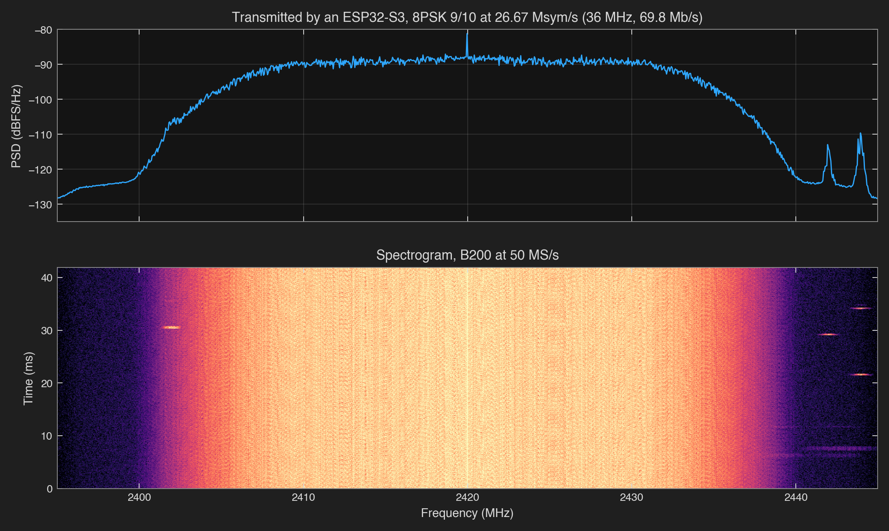

# esp-dvbs2

What started as but one hack on the ESP32-C3 has snowballed into a plethora of ESP32 software
defined radios. People have pulled raw I/Q samples out of the Wi-Fi receiver, sent FM and SSB by
steering the radio's test tone, played arbitrary waveforms through the transmit DAC, and put
DVB-S on the 13 cm band from a C3 with a PC doing the encoding.

Now... this repo goes for the whole thing: **a complete DVB-S2 transmitter running on one ESP32-S3**.
Framing, error correction, modulation and pulse shaping all happen on the chip, and the signal
leaves through the S3's own Wi-Fi radio. No PC doing the encoding, no external DAC, no FPGA.

It started with the goal of live video, 8PSK 2/3 at 5 Msym/s, 9.68 Mb/s. Then it kept going:
the same $5 chip now pushes **58.2 Mb/s in 40 MHz**, the widest channel its Wi-Fi radio was
ever built for. Read [How it got here](docs/story.md) to learn about the tumultuous journey.



One ESP32-S3, one B200 capture at 2420 MHz through 40 dB of coax attenuation.
The receiver recovered 40 exact frames from this 41.94 ms recording, using a prepared,
repeated payload. [Capture and plotting details](results/2026-10-21-rf-figures/README.md).

## Receiving on an S3

A second ESP32-S3 receives the stream and decodes all of it on the chip: it captures through
its own radio at 16 MS/s, matched-filters, tracks timing and carrier, checks or decodes LDPC and
BCH, and streams a record per frame over USB. With short frames, 8PSK 8/9 at 5 Msym/s, it
decoded every frame of three 38 s runs exactly, **12.64 Mb/s**, with no samples dropped and a
median pilot MER of 29.9 dB. One QPSK 3/4 run at 5 Msym/s (6.95 Mb/s) and one at 1 Msym/s
(1.39 Mb/s) were also exact. The receiver started before the transmitter keyed; the path was coax with
30 dB of attenuation.
[5 Msym/s results](results/2026-10-23-rx-5m-margin/README.md),
[1 Msym/s qualification](results/2026-10-22-rx-continuous/README.md),
[receiver chain](docs/how-it-works.md#receiving).

```sh
(. ~/.espressif/tools/activate_idf_v6.1.sh && cd firmware/rx && idf.py build flash)
python3 host/rx.py 16 --rate 5m --mhz 2420 --gain 32 --seconds 45 --port RX_PORT --callsign KJ5SCH
python3 host/board.py "dvb 2420 16 5m 55 0 128 --short" --port TX_PORT   # transmitter, keyed
```

## Live video

```
CM5 + cameras --SPI--> ESP32-S3 --DVB-S2 RF--> SDR --IQ--> LeanDVB --TS--> player
```

The [live-video example](examples/live-video/README.md) uses **8PSK 2/3 at 5 Msym/s**:
9.68 Mb/s TS capacity in 6.75 MHz. A CM5 sends two camera streams in a 9 Mb/s mux
over 16 MHz SPI. A B200 recovered both through 40 dB of coax attenuation, with no
TS continuity gaps in a 111 s interval. The [run records](results/2026-10-19-live-rf/README.md)
include the recovery tests. The player can still pause when the source or station ID restarts.
Finite 2.4 Mb/s H.264 files also passed USB → S3 → E200 → LeanDVB and played
on the laptop. Use the [Linux SPI sender](examples/pi-sender/README.md) for a live 9 Mb/s mux.

## What it can do

The best measured configurations on main, fastest first. **Keyed** means the S3 really transmitted for
30 s and met every bank deadline; **radio off** means the same encoder and bank schedule ran in
real time with the DAC output going nowhere.

| Mode | Symbol rate | Bandwidth | **Data rate** | Tested | RF decode |
|---|---:|---:|---:|---|---|
| 8PSK 9/10 | 26.67 Msym/s | 36 MHz | **69.8 Mb/s** | keyed | [decoded, prepared](results/2026-10-20-wide-filter/README.md) |
| 8PSK 5/6 | 26.67 Msym/s | 36 MHz | **64.6 Mb/s** | keyed | decoded, prepared |
| QPSK 9/10, roll-off 0.20 | 33.33 Msym/s | **40 MHz** | **58.2 Mb/s** | keyed | decoded, prepared |
| 8PSK 2/3 | 26.67 Msym/s | 36 MHz | **51.6 Mb/s** | keyed | decoded, prepared |
| 8PSK 5/6 | 20 Msym/s | 27 MHz | **48.4 Mb/s** | keyed* | decoded (B200) |
| QPSK 9/10 | 26.67 Msym/s | 36 MHz | 46.6 Mb/s | keyed | [decoded (B200)](results/2026-10-20-qpsk-startup/README.md) |
| 8PSK 2/3 | 20 Msym/s | 27 MHz | 38.7 Mb/s | keyed* | decoded, soft LDPC |
| QPSK 9/10 | 20 Msym/s | 27 MHz | 34.9 Mb/s | keyed | decoded, peak 32–64; 48 best |
| 8PSK 5/6 | 10 Msym/s | 13.5 MHz | 24.2 Mb/s | keyed | decoded, soft LDPC |
| QPSK 9/10 | 10 Msym/s | 13.5 MHz | 17.5 Mb/s | radio off | decoded |
| QPSK 3/4, video dry run | 10 Msym/s | 13.5 MHz | 14.5 Mb/s | host-model TS dry run | decoded (RF burst) |
| 8PSK 9/10 | 5 Msym/s | 6.75 MHz | 13.1 Mb/s | radio off | [decoded (mixed VCM)](docs/vcm.md) |
| 8PSK 2/3 | 5 Msym/s | 6.75 MHz | 9.68 Mb/s | keyed | [decoded (mixed VCM)](docs/vcm.md) |
| QPSK 1/2 | 1 Msym/s | 1.35 MHz | 0.97 Mb/s | keyed | decoded |

Roll-off is 0.35 unless noted. Rates use normal frames with pilots and exclude station-ID time.
Every row has exact RF payload recovery in LeanDVB, an independent receiver. The four fastest
modes used prepared, repeated payloads; the remaining modes include changing-payload tests.
The E200 checks used a closed Faraday box; the wider B200 checks used coax and 40 dB attenuation.
[RF records](docs/measurements.md#over-the-air).

The wide modes needed a fix to restore the radio's filter after test-tone setup.
QPSK at 26.67 Msym/s also needed a third frame buffer: three 20 s runs then had zero underruns,
with 32/31/32 exact packets in the sampled RF. [Wide filter](results/2026-10-20-wide-filter/README.md),
[startup fix](results/2026-10-20-qpsk-startup/README.md).
\*The 30 s keyed timing used an earlier, longer pulse; the current pulse decoded in these 20 s RF tests.
Margins, raw records and limits: [measurements](docs/measurements.md). With a prepared payload,
30 s keyed tests of the 40 MHz mode left **37% mean encoder headroom and 16% bank-fill headroom**.
At 36 MHz, keyed 8PSK 9/10 meets the 15% reserve on both cores; 2/3 and 5/6
run at full rate with 14% and 12% mean encoder spare.



8PSK 9/10 at 26.67 Msym/s: 69.8 Mb/s during data, with 47 exact frames recovered
from this capture. This also used a prepared, repeated payload.

## Quick start

Use Python 3.12+ in a **host shell separate from ESP-IDF**; IDF activation selects its
own Python and can hide numpy/scipy. Run all host and example commands in this shell:

```sh
python3 -m venv .venv
. .venv/bin/activate
python3 -m pip install numpy scipy pyserial
python3 -c 'import numpy, scipy, serial; print("Host dependencies OK")'
```

Install ESP-IDF v6.1 using [Espressif's ESP32-S3 setup guide](https://docs.espressif.com/projects/esp-idf/en/v6.1/esp32s3/get-started/index.html).
The activation path below is the tested macOS EIM path; substitute your installation's
activation/export script. Parentheses keep IDF's Python inside the build subshell.
Without a board, run the [host suite and build](docs/how-it-works.md#checking-changes),
the self-check `--plan`, the [sender vector](examples/pi-sender/README.md), and the
[video dry run](examples/live-video/README.md#prepare).

For board checks, the measured module is N16R8 (8 MB octal PSRAM, 16 MB flash).
The optional 8 MB flash XIAO uses a [separate configuration](docs/transmitting.md#board-and-usb).
Nothing below turns the radio on.

```sh
(. ~/.espressif/tools/activate_idf_v6.1.sh && cd firmware/tx && idf.py build flash)
python3 host/board.py info --reset
python3 host/board.py "callsign N0CALL"      # placeholder for radio-off tests only
```

Dump 16 frames of 8PSK 5/6 at 20 Msym/s over USB, exactly as the chip would transmit them,
and decode them with LeanDVB. Every payload byte should come back.

```sh
python3 examples/self-check/build_receiver.py   # builds LeanDVB under notes/
python3 host/board.py "dvbdump 15 20m 16 128 1" --save fast.iq
python3 host/decode.py fast.iq --rate 80000000 --symbol-rate 20000000 \
  --modcod 15 --stream 16 --receiver notes/leansdr/src/apps/leandvb
```

The [self-check](examples/self-check/README.md) runs the full radio-off regression in about
five minutes: seven dumps and decodes and a real-time pace of every modulation and rate path. All console commands are in [transmitting](docs/transmitting.md#console).

Opt-in [VCM](docs/vcm.md) switches MODCOD per frame, including mixed QPSK/8PSK at 5 Msym/s.
The laptop can change it mid-transmission: QPSK 1/2 → 3/4 → 9/10 → 1/2 over USB decoded
exact and in order over the air ([live VCM](examples/over-the-air/README.md)).

## Send it your data

[examples/usb-send](examples/usb-send/README.md) is one Python file (`pyserial` only) for
files, telemetry and low-rate video over native USB. Measured payload intake is **3.23 Mb/s**
at 5 Msym/s with the PSRAM encoder (radio off, 2026-10-17). It defaults to radio-off checks
and includes SHA-256 file recovery. USB and SPI senders accept `--fec 16:4` to
recover from any four missing frames per 20-frame block on a one-way link;
see [file transfer](docs/file-link.md) for overhead and the IQ-to-LeanDVB proof.
Over the air, a 237 KB PNG arrived with a matching SHA-256, including with one frame
per block deliberately dropped at the receiver ([run](docs/measurements.md#over-the-air)).

SPI carries higher rates. The sender clocks fixed 1,332-byte messages: a 12-byte
header (`PV`, version, type, sequence, length), up to seven 188-byte MPEG-TS packets and a
CRC-32. A READY pin tells the sender when the S3 has room. Single-line SPI delivered the
9 Mb/s camera mux at 16 MHz; its ideal ceiling is 19.4 Mb/s at 20 MHz. Quad SPI reached
46.6 Mb/s with on-chip loopback. Payload is MPEG-TS for video or any
bytes as a generic stream. The S3 does the rest: framing, coding, filler frames when the
input runs dry, and transmission. Select it with `spiinput on` before a run; the
[reference sender](examples/pi-sender/README.md) streams a file from a Linux board.
[Message format, pins and commands](docs/spi-input.md).

## How it works

```
payload -> BB frame -> BCH -> LDPC -> map -> PL frame -> pulse shaping -> DAC bank -> radio
           <-------------- core 0 --------------->    <--------- core 1 --------->
```

The S3's radio hides a test engine that plays samples from internal RAM straight into its I/Q
DAC. It loops one bank of 16,380 samples while the CPU fills the other and switches them on time.
At 80 MS/s a fresh bank is due every 196.75 µs, or 47,220 cycles at 240 MHz.
Core 0 encodes frames into a small ring; core 1 shapes them into samples. At 40 MHz, core 0
queues compact I/Q sign bit planes, from which core 1 extracts windows while rendering.

To pulse shape with such speed and tenacity I went a similar path to my
[RP2350 version](https://github.com/Rivercraft911/RP2350_IQ_Benchmark/tree/88ab018e65a51805ff562842177a4d47b1b04b2e): every possible output of
the shaping filter is computed once into a table, so producing samples is copying table rows
instead of doing filter math. At 40 MHz the trick goes one further: QPSK's I and Q are two BPSK
streams, so each four-sample vector comes from small sign-indexed tables and one OR.
[The encoder, fill and bank schedule](docs/how-it-works.md).

## Transmitting

Only a licensed operator should key the radio on an authorized amateur frequency, in a
shielded setup or into a dummy load, or through at least 30 dB attenuation into a receiver.
Set your assigned callsign first. The firmware sends 20 WPM Morse before and after a run;
synthetic test payloads also carry the callsign. External SPI/USB payload bytes are preserved
without an added callsign header; Morse ID remains separate. [Setup and limitations](docs/transmitting.md).
My callsign is **KJ5SCH**; use your own station's call when setting up a board.
The [contained E200 RF check](examples/over-the-air/README.md) coordinates capture,
explicit operator keying and exact payload verification; it also supports offline USB replay.

## More

| Path | What's there |
|---|---|
| `firmware/` | Console, transmitter, encoder, radio, station ID and SPI input; `firmware/rx` is the receiver |
| `host/` | Board protocol, independent decode, Python reference encoder, figures |
| `examples/` | [Self-check](examples/self-check/README.md), [live video](examples/live-video/README.md), [SPI sender](examples/pi-sender/README.md) |
| `tests/` | Standard vectors, C/Python agreement and stream CRCs ([running them](docs/how-it-works.md#checking-changes)) |
| `docs/` | [How it works](docs/how-it-works.md), [transmitting](docs/transmitting.md), [SPI input](docs/spi-input.md), [measurements](docs/measurements.md), [story](docs/story.md), [credits](docs/prior-art.md) |

Additional experiments and raw results live in
[archive/dev-2026-10-17](https://github.com/Rivercraft911/esp-dvbs2/tree/archive/dev-2026-10-17).

## Licence

[Apache-2.0](LICENSE). Copyright 2026 River Dowdy; see [NOTICE](NOTICE). Findings from other projects are credited in
[prior-art.md](docs/prior-art.md).
