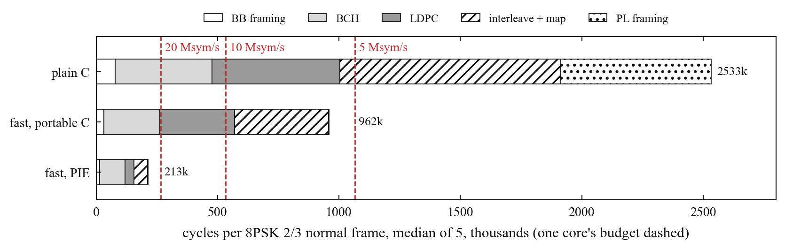
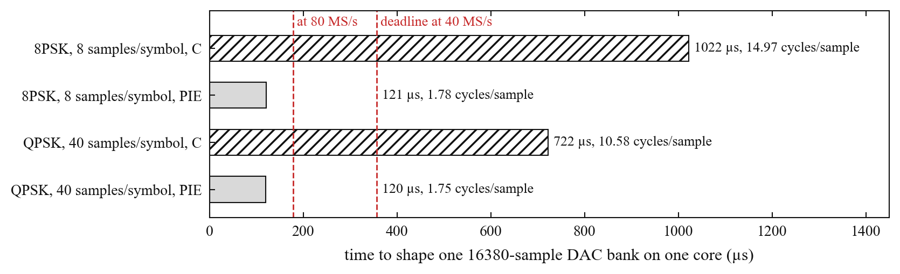

# esp-dvbs2

What started as but one hack on the ESP32-C3 has snowballed into a plethora of ESP32 software
defined radios. People have pulled raw I/Q samples out of the Wi-Fi receiver, sent FM and SSB by
steering the radio's test tone, played arbitrary waveforms through the transmit DAC, and put
DVB-S on the 13 cm band from a C3 with a PC doing the encoding.

Now... this repo goes for the whole thing: **a complete DVB-S2 transmitter running on one ESP32-S3**.
Framing, error correction, modulation and pulse shaping all happen on the chip, and the signal
leaves through the S3's own Wi-Fi radio.

**The goal is live video:** 8PSK rate 2/3 at 5 Msym/s carries 9.68 Mb/s in about 6 MHz of the
13 cm amateur band. [How it got this far](docs/story.md), step by step.

## Where it stands

| | Best so far | Run |
|---|---|---|
| Continuous transmit | 8PSK 2/3 at 20 Msym/s (38.7 Mb/s) and 5/6 (48.4 Mb/s) from the 80 MS/s DAC, keyed for 30 s each in a shielded box, every bank deadline met, 4% slack | [keyed](results/2026-10-16-keyed-20m/README.md) |
| Bit-exact from the chip | QPSK 1/2 to 9/10 at 1 Msym/s, 8PSK 2/3 and 5/6 at 5 and 10 Msym/s: the DAC samples decoded by LeanDVB, radio off | [QPSK](results/2026-10-16-dryrun/README.md), [8PSK](results/2026-10-16-8psk-board/README.md) |
| MER of those samples | 47.0 dB QPSK at 1 Msym/s; 8PSK 43.3 dB at 5 and 41.6 dB at 10 Msym/s after a modelled DAC hold | [QPSK](results/2026-10-16-dryrun/README.md), [8PSK](results/2026-10-16-integrate/README.md) |
| Encoder | 166k cycles per 8PSK 2/3 frame in the live stream: 62% of one core at 20 Msym/s | [radio off](results/2026-10-16-next2/README.md), [keyed](results/2026-10-16-keyed-20m/README.md) |
| Pulse shaping | 1.78 cycles per sample; a whole bank at 20 Msym/s in 45.1k of its 47.2k cycles | [shaper](results/2026-10-16-shaper/README.md), [20 Msym/s](results/2026-10-16-20msym/README.md) |
| RF, test tone | image -35 dBc, carrier leak about -45 dBc | [first RF](results/2026-10-16-radio/README.md) |
| Payload in | 4.6 Mb/s over USB | [usb](results/2026-10-16-usb/README.md) |

Not yet: a receiver decoding the signal over RF, 26.67 Msym/s (at 3 samples per symbol the best
kernel so far needs 46.4k cycles for a bank due every 47.2k), and payload arriving over SPI.

## How it works

```
payload ─▶ BB frame ─▶ BCH ─▶ LDPC ─▶ 8PSK map ─▶ PL frame ─▶ pulse shaping ─▶ DAC bank ─▶ radio
           └────────────── one core ──────────────┘          └──────── other core ────────┘
```

The S3's radio contains an undocumented test engine that plays samples from internal RAM
straight into its I/Q DAC. It loops over one bank of 16380 samples at 40 MS/s (409.5 µs per
pass) with no CPU help, while the CPU fills a second bank and switches them on time. That refill
is the budget that decides everything: at 40 MS/s a fresh bank is due every 357 µs.

To pulse shape with such speed and tenacity I went a similar path to my [RP2350 version](https://github.com/Rivercraft911/RP2350_IQ_Benchmark):
every possible output of the shaping filter is computed once into a table, so producing
samples is copying table rows instead of doing filter math. At 5 Msym/s one symbol is one row of
8 samples. There are a bunch of ways you can play with this idea as you try more complex waveforms.

## Encoding a frame in 213k cycles



Tables, whole-word operations and PIE vector kernels encode an 8PSK 2/3 normal frame in 213k
cycles, 12 times fewer than the plain C encoder in the same build: 20% of one core at 5 Msym/s,
enough on its own for about 25 Msym/s. Every output matches the Python reference. In the live
stream a frame still costs about 700k cycles, because the stream also makes the payload and
writes each frame to PSRAM. A frame lasts 533k cycles at 10 Msym/s, so that is the next cut.
[Run details](results/2026-10-16-fec-limit/README.md).

## Pulse shaping at 1.78 cycles per sample



Real 8PSK samples, a 9-symbol root-raised-cosine pulse, go into a DAC bank at 1.78 cycles per
sample using the S3's 128-bit vector instructions. Each sample is the sum of three table words,
so the whole 8PSK table fits in 64 KiB. That is 34% of one core at 40 MS/s, and 68% at 80 MS/s,
the rate that would allow 20 Msym/s. [Run details](results/2026-10-16-shaper/README.md).

Unlike the RP2350's external DAC, whose clock followed the symbol rate (4 samples per symbol),
the S3's DAC engine only runs at 40 or 80 MS/s. Samples per symbol therefore follow from the
symbol rate: 40 at 1 Msym/s, 8 at 5, 4 at 10, 3 at 13.33. The shaping work per second depends
only on the DAC rate, so a higher symbol rate costs no extra shaping, only encoder time.

## Next

- A wider transmit filter for 20 Msym/s, and more fill margin than 4%.
- 26.67 Msym/s at 3 samples per symbol.
- A 6-symbol pulse: two table lookups per sample instead of three.
- A receiver decoding the signal over RF, starting with a cabled path.
- Payload over SPI from a second board, APSK in firmware.

## Build and run

Needs ESP-IDF v6.1, an ESP32-S3 with 8 MB of PSRAM, Python 3 with numpy, pyserial and matplotlib.
The host IQ tools also need scipy. Independent loopback needs a separate local LeanDVB build.

```sh
python3 tests/test_dvbs2.py                     # reference encoder checks, no hardware
python3 tests/test_dvbs2_8psk.py                # independent 8PSK standard-formula checks
python3 tests/test_dvbs2_apsk.py                # normal 16APSK/32APSK formulas and stage digests
python3 tests/test_dvbs2_c.py                   # compile with cc, compare every C stage
python3 tests/test_fecbench.py                  # seeded benchmark frames and output CRCs
python3 tests/test_iq.py                        # RRC waveform and capture formats, no hardware
python3 tests/test_decode.py                    # receiver output parsing and failure checks
python3 tests/test_ring.py                      # encoder-to-fill frame ring against the bank schedule
cd firmware && idf.py build flash && cd ..      # after sourcing ESP-IDF
python3 host/board.py info --reset              # talk to the board
python3 host/board.py membench --out results/<date>-<topic>/runs.jsonl
python3 host/board.py fecbench --reset --timeout 120 --out results/<date>-encoder/runs.jsonl
python3 host/board.py "fecbench pie" --timeout 120 --out results/<date>-encoder/runs.jsonl  # or c
python3 tests/test_fecbench.py results/<date>-encoder/runs.jsonl
python3 host/board.py "dvbdump 4 40" --save dump.iq   # the transmit samples over USB, radio off
python3 host/onair.py dump.iq --rate 4000000 --scale 512 --stream 40   # LeanDVB decode, payload check
python3 host/board.py "dvbdump 13 5m 40 128 1" --save dump8.iq   # 8PSK 2/3, 5 Msym/s, every sample
python3 host/onair.py dump8.iq --rate 40000000 --stream 40 --mer --shift 0
python3 host/board.py "dvbpace 4 60" --timeout 120  # encoder and timed bank fills, radio off
python3 host/board.py "dvbpace 13 5m 60" --timeout 120  # the same for 8PSK 2/3 at 5 Msym/s
python3 host/plots.py                           # redraw the figures from results/
```

## Where things are

| Path | What |
|---|---|
| `firmware/` | ESP-IDF application |
| `host/` | Python reference encoder, board tool, figures |
| `tests/` | Bit-exact checks of the reference |
| `results/` | One folder per measurement run, with its raw records |
| `docs/` | [The story so far](docs/story.md), [prior art](docs/prior-art.md), [bench setup](docs/hardware.md), [files over the link](docs/file-link.md), [APSK shaping](docs/apsk-shaping.md), [bank geometry at 80 MS/s](docs/bank-geometry.md), figures |

## Transmitting

Operating outside the Wi-Fi channels needs an amateur radio licence, and the firmware is meant
for licensed use in the 13 cm band. Bench tests go into a dummy load or through at least 30 dB
of attenuation into a receiver. Set `callsign <assigned CALL>` over `host/board.py` first;
`callsign` reads it, `callsign clear` removes it, and `info` reports it. The setting survives
reset. Without it, `tx` and `dvb` refuse before radio startup; radio-off commands still work.

The transmit command is `dvb <MHz> <MODCOD> [5m|10m for 8PSK] <seconds> [gain] [peak]`.

Each keyed run includes 20 WPM Morse at +1 MHz before and after its payload, with periodic
ID every nine minutes. Requested seconds include both IDs and remain limited to 60 s; too-short runs refuse before RF.
DVB payload frames also carry the callsign; add `--callsign CALL` to `host/onair.py` when checking
them. `iddump CALL` and `host/morse.py` verify the CW samples without radio access.
A keyed 30 s run held every bank deadline with both IDs; the radiated Morse has not been received yet.
See [docs/hardware.md](docs/hardware.md#station-identification) for the rule, limitations and
radio-off coordinator commands.

## Licence

Apache-2.0. Everything here is written from scratch; the projects that showed the way are
credited in [docs/prior-art.md](docs/prior-art.md).

DVB-S2 has left the chip, so far into a shielded box. A receiver decoding it is next. Coming soon to a repo near you!
