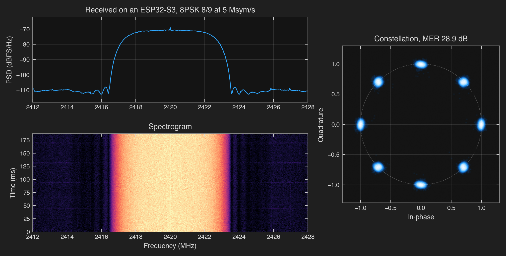
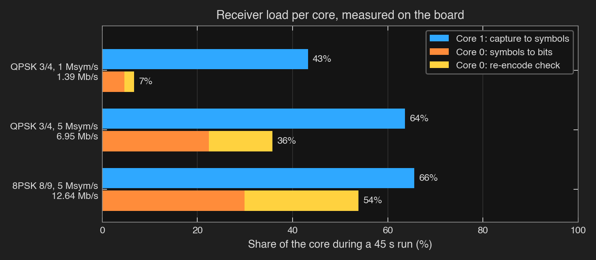
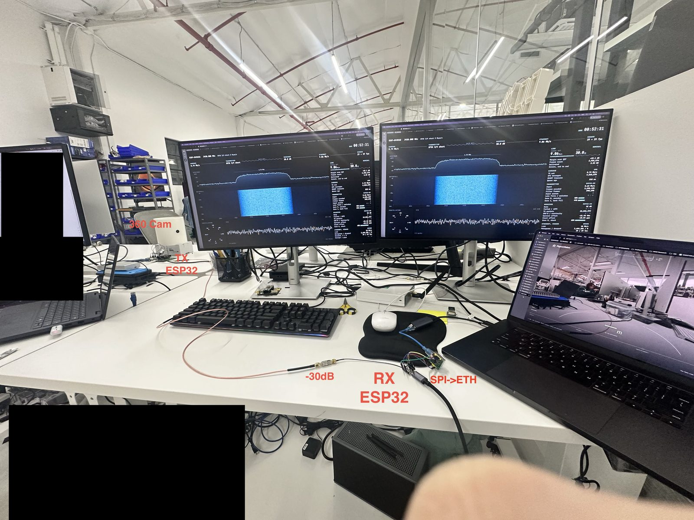

# esp-dvbs2

What started as but one hack on the ESP32-C3 has snowballed into a plethora of ESP32 software
defined radios. People have pulled raw I/Q samples out of the Wi-Fi receiver, sent FM and SSB by
steering the radio's test tone, played arbitrary waveforms through the transmit DAC, and put
DVB-S on the 13 cm band from a C3 with a PC doing the encoding.

Now... this repo goes for the whole shebang: **a complete DVB-S2 transceiver running on the
ESP32-S3**. One S3 frames, codes, modulates and pulse-shapes the signal and sends it out of its
own Wi-Fi radio. A second S3 pulls it back in through its own radio and demodulates and decodes
every frame on the chip. No PC doing the encoding or the decoding, no external DAC or ADC, no
FPGA.

It started with the goal of live video, 8PSK 2/3 at 5 Msym/s, 9.68 Mb/s. Then it kept going:
the same $5 chip now pushes **69.8 Mb/s in 36 MHz** and **58.2 Mb/s in 40 MHz**, the widest
channel its Wi-Fi radio was ever built for, and a second one receives **12.64 Mb/s** and
decodes every byte of it. Read [How it got here](docs/story.md) to learn about the tumultuous
journey.

<p align="center"></p>

QPSK 9/10 at 33.33 Msym/s from one ESP32-S3, captured by a B200 at 2420 MHz through coax and
attenuation: 41.94 ms, 40 exact frames from a prepared payload
([capture details](results/2026-10-21-rf-figures/README.md)). The same mode has since been keyed
with a payload that never repeats ([keyed table](results/2026-10-23-tx-table/README.md)).

## What it transmits

Every row was keyed for 30 s with a payload that never repeats and decoded by LeanDVB, an
independent receiver, from B200 captures for each run. Every recovered frame was bit-exact!
([keyed table](results/2026-10-23-tx-table/README.md), [8PSK re-key](results/2026-10-23-tx-table-8psk-rekey/README.md),
[80 MS/s fill confirmation](results/2026-10-23-tx-fill-keyed/README.md)). Spare is the % of each core left
over.

| Mode | Symbol rate | Bandwidth | Payload | Exact frames | Spare, encoder / fill |
|---|---:|---:|---:|---:|---:|
| 8PSK 9/10 | 26.67 Msym/s | 36 MHz | **69.8 Mb/s** | 947 | 21.5% / 22.7% |
| 8PSK 5/6 | 26.67 Msym/s | 36 MHz | **64.6 Mb/s** | 947 | 16.8% / 21.8% |
| QPSK 9/10, roll-off 0.20 | 33.33 Msym/s | **40 MHz** | **58.2 Mb/s** | 793 | 30.1% / 17.7% |
| 8PSK 9/10 | 20 Msym/s | 27 MHz | **52.4 Mb/s** | 706 | 53.8% / 17.5% |
| 8PSK 2/3 | 26.67 Msym/s | 36 MHz | **51.6 Mb/s** | 946 | 20.5% / 21.9% |
| 8PSK 5/6 | 20 Msym/s | 27 MHz | 48.4 Mb/s | 706 | 40.2% / 17.4% |
| QPSK 9/10 | 26.67 Msym/s | 36 MHz | 46.6 Mb/s | 632 | 59.3% / 20.7% |
| 8PSK 2/3 | 20 Msym/s | 27 MHz | 38.7 Mb/s | 706 | 49.2% / 17.3% |
| QPSK 9/10 | 20 Msym/s | 27 MHz | 34.9 Mb/s | 227 | 68.5% / 23.5% |
| 8PSK 9/10 | 10 Msym/s | 13.5 MHz | 26.2 Mb/s | 529 | 77.0% / 50.0% |
| 8PSK 5/6 | 10 Msym/s | 13.5 MHz | 24.2 Mb/s | 406 | 69.5% / 50.1% |
| QPSK 9/10 | 10 Msym/s | 13.5 MHz | 17.5 Mb/s | 353 | 80.1% / 49.7% |
| 8PSK 9/10 | 5 Msym/s | 6.75 MHz | 13.1 Mb/s | 337 | 73.7% / 55.3% |
| 8PSK 8/9, short frames | 5 Msym/s | 6.75 MHz | 12.64 Mb/s | 1,697 | 76.4% / 55.5% |
| 8PSK 2/3 | 5 Msym/s | 6.75 MHz | 9.68 Mb/s | 334 | 76.1% / 55.4% |
| QPSK 1/2 | 1 Msym/s | 1.35 MHz | 0.97 Mb/s | 111 | 91.6% / 51.4% |

Roll-off is 0.35 unless noted. Rates use normal frames with pilots, except the short-frame row,
and leave out the Morse ID. The encoder also keeps up with payload arriving through the real SPI input code: QPSK 9/10 at
40 MHz ran at full rate with TS input replayed on the chip, keeping 15.5% encoder and 16.2% fill
spare ([fill confirmation](results/2026-10-23-tx-fill-keyed/README.md)).

<p align="center"></p>

## Receiving on an S3

The second S3 captures 16 MS/s through its own radio, matched-filters it, finds and follows the
frames, and checks every one by encoding it again. LDPC decoding only runs when a frame fails that check.
Every short-frame mode the transmitter sends decodes live:

| Modes | Symbol rate | Payload | Frames, all exact | Pilot MER, median | Core 1 / core 0 |
|---|---:|---:|---:|---:|---:|
| QPSK 1/2 to 8/9 | 1 Msym/s | 0.83 to 1.69 Mb/s | 19,705 | 30.2 to 30.3 dB | 43% / 7 to 8% |
| QPSK 1/2 to 8/9 | 5 Msym/s | 4.15 to 8.45 Mb/s | 98,213 | 29.7 to 29.8 dB | 61% / 39 to 43% |
| 8PSK 3/5 to 8/9 | 5 Msym/s | 8.46 to 12.64 Mb/s | 105,235 | 29.6 to 29.8 dB | 63% / 60 to 63% |

For 19 live 30 s runs, 223,153 frames, none lost, none failed, no relocks
([sweep](results/2026-10-23-rx-sweep/README.md)).

<p align="center"></p>

That is the receiver's own 16 MS/s capture of 8PSK 8/9 at 5 Msym/s, and the constellation its
demodulator produced from it: 164 of 164 frames exact
([figures](results/2026-10-23-rx-figures/README.md)). The receiver never starts Wi-Fi; it
calibrates the PHY directly ([no Wi-Fi](results/2026-10-23-rx-no-wifi-ab/README.md)). It also speaks MPEG transport stream:
1,738,344 TS packets crossed the S3 link with every one exact, and the receiver rode through
95,810 filler frames from a transmitter starved of input without losing lock
([TS link](results/2026-10-23-ts-link/README.md)).

```sh
(. ~/.espressif/tools/activate_idf_v6.1.sh && cd firmware/rx && idf.py build flash)
python3 host/rx.py 16 --rate 5m --mhz 2420 --gain 32 --seconds 45 --port RX_PORT --callsign YOURCALL
python3 host/board.py "dvb 2420 16 5m 55 0 128 --short" --port TX_PORT --timeout 90   # keys the transmitter
```

`YOURCALL` must match the callsign stored on the transmitter: the receiver's check rebuilds the
transmitter's payload, station header included.

<p align="center"></p>

## Live video, one S3 to another

https://github.com/user-attachments/assets/d9fcb80d-3431-469d-b2b3-6987c60373bc

Remember the goal this all started with? Here it is, with no PC anywhere in the radio path. A
CM5 encodes two 200-degree fisheye cameras into an 8 Mb/s MPEG transport stream and clocks it over SPI
into one S3, which sends it as 8PSK 3/4 at 5 Msym/s on 2420 MHz. Coax and 30 dB of attenuation
carry it to a second S3, which demodulates and decodes it on the chip and pushes the packets out of
a W5500 Ethernet module to a laptop, where PigeonVision stitches the two cameras into one 360°
view. A dashboard, `host/monitor.py`, watches the link.

For the live demo, it ran 16 back-to-back 540 s runs, 2.4 hours on air: 5,725,408 frames decoded
with none failed, median pilot MER about 25.5 dB, no relocks, 6.1 million datagrams out of the
W5500 with none dropped, and both cameras at 30.0 frames/s
([live demo](results/2026-10-23-live-demo/README.md)). Not quite perfect... the receiver dropped
11 frames when its release task fell behind, about one every 13 minutes, and some datagrams go
missing between the W5500 and the laptop.

<p align="center"></p>

The bench: the dashboard on both monitors, the stitched view on the laptop. The W5500 runs at
10 Mb/s, which carries up to 9.46 Mb/s of transport stream; at 100 Mb/s it kept losing its link on
the XIAO's 3.3 V supply ([bring-up](results/2026-10-23-eth-bringup/README.md),
[full quality](results/2026-10-23-eth-full-quality/README.md)).
[How to run it](examples/live-video/README.md#esp32-s3-to-esp32-s3).

## How it works

```
transmit  core 0: payload -> BB frame -> BCH -> LDPC -> map -> PL frame -> frame ring
          core 1: frame ring -> pulse shaping -> DAC bank -> the S3's radio
receive   core 1: the S3's radio -> 16 MS/s bank -> matched filter -> sync -> symbol ring
          core 0: symbol ring -> derotate, demap -> re-encode check -> (LDPC) -> payload
```

The S3's radio hides a test engine that plays samples from internal RAM straight into its I/Q
DAC, and a dump engine that writes what the receiver hears into RAM. Both work in banks. On the
transmit side a fresh 16,380-sample bank is due every 196.75 µs at 80 MS/s: 47,220 CPU cycles
to make 15,740 new samples. On the receive side the dump engine fills a 16,384-sample ring and
hands the receiver 12,288 new samples every 768 µs.

To pulse shape with such speed and tenacity I went a similar path to my
[RP2350 version](https://github.com/Rivercraft911/RP2350_IQ_Benchmark/tree/88ab018e65a51805ff562842177a4d47b1b04b2e): every possible output of
the shaping filter is computed once into a table, so producing samples is copying table rows
instead of doing filter math. The heavy DSP loops on both sides (shaping, BCH and LDPC, matched
filtering, demapping) run on the S3's 128-bit PIE vector unit. Neither app starts Wi-Fi, and
once booted neither touches the heap during a run; only setup commands such as `spiinput` and
`callsign` do.
[How it works](docs/how-it-works.md), then the [transmitter](docs/transmitter.md) and the
[receiver](docs/receiver.md) in depth.

## Quick start

Use Python 3.12+ in a **host shell separate from ESP-IDF**; IDF activation selects its
own Python and can hide numpy/scipy. Run all host and example commands in this shell:

```sh
python3 -m venv .venv
. .venv/bin/activate
python3 -m pip install numpy scipy pyserial
for test in tests/test_*.py; do python3 "$test" || exit 1; done
```

Install ESP-IDF v6.1 using [Espressif's ESP32-S3 setup guide](https://docs.espressif.com/projects/esp-idf/en/v6.1/esp32s3/get-started/index.html),
then build and flash the two apps. Parentheses keep IDF's Python inside the build subshell.
XIAO ESP32-S3 boards (8 MB flash) use a [separate configuration](docs/transmitting.md#board-and-usb).
Nothing below turns the radio on.

```sh
(. ~/.espressif/tools/activate_idf_v6.1.sh && cd firmware/tx && idf.py build flash)
(. ~/.espressif/tools/activate_idf_v6.1.sh && cd firmware/rx && idf.py build flash)
python3 host/board.py info --reset
python3 host/board.py "callsign N0CALL"      # placeholder for radio-off tests only
```

Dump 16 frames of 8PSK 5/6 at 20 Msym/s over USB, exactly as the chip would transmit them,
and decode them with LeanDVB. Every payload byte should come back.

```sh
python3 examples/self-check/build_receiver.py   # builds LeanDVB under notes/
python3 host/board.py "dvbdump 15 20m 16 128 1" --save fast.iq
python3 host/decode.py fast.iq --rate 80000000 --symbol-rate 20000000 \
  --modcod 15 --stream 16 --receiver notes/leansdr/src/apps/leandvb
```

The [self-check](examples/self-check/README.md) runs the full radio-off regression. Every console
command for both apps is in [transmitting and receiving](docs/transmitting.md#console).

## Send it your data

[examples/usb-send](examples/usb-send/README.md) is one Python file (`pyserial` only) for
files, telemetry and low-rate video over native USB, with SHA-256 file recovery and optional
`--fec 16:4`, which recovers any four missing frames per 20-frame block on a one-way link
([file transfer](docs/file-link.md)). SPI carries more: fixed 1,332-byte messages of up to seven
188-byte MPEG-TS packets with a CRC-32, paced by a READY pin
([message format, pins and commands](docs/spi-input.md)). A CM5 sent two camera streams in a
9 Mb/s mux over 16 MHz SPI, and a B200 recovered both, with no TS continuity gaps in 111 s
([live video](examples/live-video/README.md), [records](results/2026-10-19-live-rf/README.md)).
Opt-in [VCM](docs/vcm.md) switches MODCOD (modulation and code rate) per frame.

## Transmitting

Only a licensed operator should key the radio, on an authorized amateur frequency, in a
shielded setup or into a dummy load, or through at least 30 dB of attenuation into a receiver.
Store your own callsign first; the firmware sends it in 20 WPM Morse before and after every run,
and the synthetic test payloads carry it too. External payload bytes are sent untouched.
[Setup and limitations](docs/transmitting.md).

## More

| Path | What's there |
|---|---|
| `firmware/tx` | The transmitter app: console, stream control, encoder and fill loops |
| `firmware/rx` | The receiver app: capture, the receive tasks, replay |
| `firmware/components` | Shared parts: `dvbs2` encoder, `dvbs2rx` demodulator and FEC, `shaper`, `radio_s3`, `platform`, `ingress`, `station_id`, `w5500` Ethernet |
| `host/` | Board protocol, Python reference encoder, receiver checks, the live dashboard (`monitor.py`), the UDP relay (`udp_ts.py`), figures |
| `examples/` | [Self-check](examples/self-check/README.md), [USB send](examples/usb-send/README.md), [SPI sender](examples/pi-sender/README.md), [live video](examples/live-video/README.md), [over the air](examples/over-the-air/README.md) |
| `tests/` | Standard vectors, C/Python agreement, pinned output CRCs ([running them](docs/how-it-works.md#checking-changes)) |
| `results/` | The run records since 2026-10-19, one folder per run with its README and raw records; earlier evidence is indexed in [measurements](docs/measurements.md#earlier-work) |
| `docs/` | [How it works](docs/how-it-works.md), [transmitter](docs/transmitter.md), [receiver](docs/receiver.md), [transmitting and receiving](docs/transmitting.md), [SPI input](docs/spi-input.md), [measurements](docs/measurements.md), [story](docs/story.md), [credits](docs/prior-art.md) |

## Licence

[Apache-2.0](LICENSE). Copyright 2026 River Dowdy; see [NOTICE](NOTICE). Findings from other projects are credited in
[prior-art.md](docs/prior-art.md).
