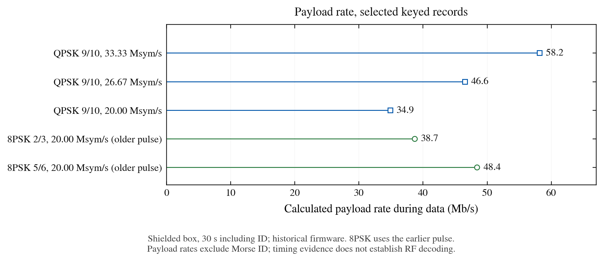
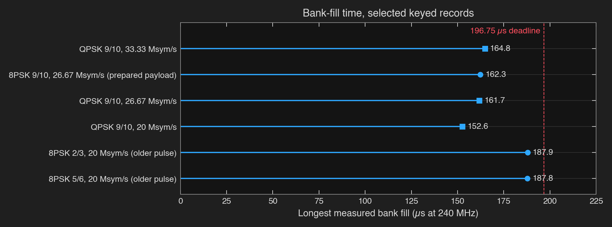

# Measurements

Every board run lives in its own folder under [`results/`](../results/), a README that says what
was measured and how, and the raw records in `runs.jsonl`; a folder is never edited after its
run. This page is the index: newest first, grouped by what the run measured, with the headline
numbers and their limits. Runs from before `results/` existed are copied into
[`docs/measurements/`](measurements/) with their provenance and SHA-256 hashes in
[sources.json](measurements/sources.json), and summarized [at the end](#earlier-work).

Words the records use:
- **Keyed**: the S3 really transmitted, into coax with attenuation and a receiver, or earlier
  into a closed lab Faraday box. **Radio off**: the same encoder and bank schedule in real time
  (`dvbpace`), or a sample dump over USB (`dvbdump`), with no RF.
- **Fresh payload**: new bytes every frame (the xorshift32 stream, or input replayed through the
  real SPI parser). **Prepared payload**: one stored payload encoded again for every frame.
- **Spare** or **reserve**: 1 minus the encoder's mean cycles over the frame period (core 0), or
  1 minus the slowest bank fill over the bank deadline (core 1).
- All boards ran at 240 MHz. The B200 and S3-to-S3 campaigns in `results/` are conducted: coax
  and attenuators. The earlier E200 runs used antennas, with the transmitter and receiver both
  inside a closed Faraday box. Neither kind of path says anything about range or absolute power.

## Transmit: timing, memory and kernels

| Record | Headline |
|---|---|
| [2026-10-23-tx-fill-keyed](../results/2026-10-23-tx-fill-keyed/README.md) | Keyed confirmation of the core-1 fill work into the B200: every 80 MS/s row at least 16.2% fill spare, 8,961 frames exact, a 540 s run with no late fill; the core-1 tick catches up in 0.76 s after a 540 s run, with the transmitter already off. |
| [2026-10-23-tx-ts-rolloff](../results/2026-10-23-tx-ts-rolloff/README.md) | QPSK at 33.33 Msym/s with TS input was shaped at roll-off 0.20 under BBHEADERs that said 0.35; the board's dumps matched the independent model with 0.35 headers sample for sample. Since bdf9cf6 they match the model with 0.20 headers. Also corrects the fill record's description of core 1's tick. |
| [2026-10-23-tx-fill](../results/2026-10-23-tx-fill/README.md) | Every 80 MS/s mode keeps at least 17.2% of its 47,220-cycle bank deadline on core 1, radio off (was 12.9%): fill phases timed only in dumps, and core 1's FreeRTOS tick off during runs. Worst fill 39,098 cycles at QPSK 1/2, 33.33 Msym/s. |
| [2026-10-23-tx-ts-input](../results/2026-10-23-tx-ts-input/README.md) | QPSK 9/10 at 33.33 Msym/s with TS input replayed: 15.3% encoder spare (was 14.1%), keyed 793 of 793 frames exact with 15.4% fill spare. The PV wire check costs 34.3k cycles a frame, 14.3%. 8PSK 9/10 at 26.67 Msym/s with TS replayed runs at full rate on 3.9% spare. A capacity test: no real wire has fed these rates. |
| [2026-10-23-tx-pie-bench](../results/2026-10-23-tx-pie-bench/README.md) | The transmitter's PIE kernels match their references on the board in every configuration the transmitter uses: 82,493 cases. Not covered: the Morse ID's `station_repeat40` (pinned ID dumps only); the slot copy has its own 128-case run in tx-ts-input. One unused path, the generic mapper on short 8PSK frames, gets the last 12 to 40 symbols wrong. |
| [2026-10-23-tx-8psk-20m](../results/2026-10-23-tx-8psk-20m/README.md) | 8PSK 9/10 at 20 Msym/s from 254,280 to 124,130 cycles a frame (4.5% to 53.4% spare, radio off): its 8 KiB BCH pair tables moved from flash to internal RAM, and 310 flash misses a frame went to 0. |
| [2026-10-23-tx-self-check](../results/2026-10-23-tx-self-check/README.md) | The board [self-check](../examples/self-check/README.md) passed 30 of 30 on 27259c5: 7 golden dumps decoded, 12 paces within their gates, VCM, and no heap call after boot. |
| [2026-10-23-tx-8psk](../results/2026-10-23-tx-8psk/README.md) | 8PSK at 26.67 Msym/s with a fresh payload, radio off: 20.2%, 16.5% and 21.3% encoder spare at 2/3, 5/6 and 9/10 (was 6.1%, 1.8% and 9.8%). Every dump equals the Python model; dumps now wait for whole frames, so their CRCs are fixed. |
| [2026-10-23-tx-run-memory](../results/2026-10-23-tx-run-memory/README.md) | No heap call after boot through paces, a keyed run, dumps, `fecbench` and `iddump`. Run memory: 38,672 + 32,768 B internal, 393,216 B PSRAM; the largest run in this campaign took 57,088 B internal (a later TS-replay pace took 67,936 B, tx-8psk). |
| [2026-10-23-tx-no-wifi](../results/2026-10-23-tx-no-wifi/README.md) | Wi-Fi removed from the transmitter: every QPSK 9/10 5 Msym/s frame LeanDVB recovered from six keyed A/B runs was exact, 22 paces kept their deadlines, internal-RAM low-water marks rose 19 to 37 KB, the image shrank from 939 to 544 KB. Its tone-level difference was later traced to the method (next group). B200 on RX2. |
| [2026-10-23-tx-budget](../results/2026-10-23-tx-budget/README.md) | Per-stage encoder cycles for every kept mode on c559548, before the encoder work above: 8PSK at 26.67 Msym/s missed its frame budget by 1.8 to 10.1% with a fresh payload. A prepared payload costs 3k to 6k cycles a frame against 30k to 54k for xorshift, which is why earlier prepared-payload records showed more spare. |
| [2026-10-23-tx-pins](../results/2026-10-23-tx-pins/README.md) | Linker pins on absolute addresses became pins on each kernel's offset in a 32-byte fetch line; every paced mode's slowest fill and encoder mean stayed within +1% or within the old build's own spread. |

## RF: keyed into a B200

| Record | Headline |
|---|---|
| [2026-10-23-tx-table-8psk-rekey](../results/2026-10-23-tx-table-8psk-rekey/README.md) | Six 8PSK rows re-keyed after the internal pair tables: 4,787 recovered frames, every one exact, no dummies. 8PSK 9/10 at 20 Msym/s now keeps 53.7% encoder spare (was 3.9%); 26.67 Msym/s keeps 20.2%, 16.5% and 21.4%. |
| [2026-10-23-tx-table-8psk](../results/2026-10-23-tx-table-8psk/README.md) | 8PSK at 26.67 Msym/s keyed with a fresh payload at 15% or more spare on both cores: 2,840 recovered frames, every one exact. With TS replayed, 9/10 delivers the full 69.8 Mb/s (was 64.8). |
| [2026-10-23-tx-table](../results/2026-10-23-tx-table/README.md) | 19 selected transmitter configurations keyed 30 s with a fresh payload and decoded by LeanDVB from four short B200 captures each: 10,219 recovered frames, 0 wrong, 0.97 to 69.8 Mb/s. QPSK 9/10 at 40 MHz keeps 14.2% fill spare, under 15%. Also: the B200's RX2 port, used by earlier same-day records, receives the signal only by leakage, about 19 dB weaker than TX/RX. |
| [2026-10-23-tx-no-wifi-checks](../results/2026-10-23-tx-no-wifi-checks/README.md) | Output level with and without Wi-Fi matches within the 0.9 dB run spread. A 535 s keyed run with no periodic PHY tracking: six sampled 0.5 s bursts recovered 355 frames, every one exact; best-frame MER spanned 17.2 to 18.2 dB, 0.2 dB lower at the end than the start. B200 on RX2. |
| [2026-10-23-short-5m](../results/2026-10-23-short-5m/README.md) | Short QPSK and 8PSK frames at 5 Msym/s, bit exact against the model on host and board. Over coax LeanDVB delivered 24,473 of 26,832 8PSK 8/9 frames, 0 wrong, at peak 508; at peak 64 it delivered none. |
| [2026-10-22-short-frames](../results/2026-10-22-short-frames/README.md) | Short QPSK frames at 1 Msym/s, bit exact. Stock LeanDVB's short 3/4 LDPC table sets `ncols` 3 for a 12-entry row; fixed, it decodes with 0 flips. Over RF it delivered 78% to 95% of short frames, every one exact. |
| [2026-10-21-rf-figures](../results/2026-10-21-rf-figures/README.md) | The [36 MHz](img/rf-36mhz.png) and [40 MHz](img/rf-40mhz.png) figures: single 41.94 ms B200 captures at 50 MS/s, 47 and 40 exact frames from prepared payloads. |
| [2026-10-20-qpsk-startup](../results/2026-10-20-qpsk-startup/README.md) | A third QPSK slot ends the startup underruns at 26.67 Msym/s: three 20 s runs, 0 underruns, 32, 31 and 32 exact frames. |
| [2026-10-20-wide-filter](../results/2026-10-20-wide-filter/README.md) | The CW bring-up reset the analog filter; restoring PBUS(4,2)=32 took the wide modes from zero decoded frames to exact payloads in all eight, 36 and 40 MHz included. |
| [2026-10-20-band-followup](../results/2026-10-20-band-followup/README.md) | 2000 MHz through the radio's five-sixths divider: 4,505 consecutive exact packets in 30 s. A private soft-FEC prototype passed 2245 MHz 8PSK for 30 s. |
| [2026-10-20-s-band-repeat](../results/2026-10-20-s-band-repeat/README.md) | 2200 and 2290 MHz, 8PSK 2/3 at 5 Msym/s for 30 s each: 6,755 consecutive exact packets each, 9.673 Mb/s. |
| [2026-10-20-s-band](../results/2026-10-20-s-band/README.md) | Changing payloads decoded exact at seven carriers from 2025 to 2420 MHz; two sustained attempts failed, causes unresolved. |
| [2026-10-19-live-rf](../results/2026-10-19-live-rf/README.md) | A CM5's 9 Mb/s two-camera TS mux over 16 MHz SPI, 8PSK 2/3 at 5 Msym/s: no TS continuity gaps in 111 s through 40 dB. A completed 140 s run took 106,227 SPI messages with no protocol errors. |

## Receive: S3 to S3

The live receive runs are one S3 into another through coax and 30 dB of attenuation at 2420 MHz,
short frames with pilots, receive gain index 32. The demodulator record also replays captures
taken at other gains and carriers.

| Record | Headline |
|---|---|
| [2026-10-23-rx-ts-crc](../results/2026-10-23-rx-ts-crc/README.md) | The TS deframer's CRC-8 on the PIE column kernel: 38.1k to 28.4k cycles a frame at 8PSK 8/9 TS without the pattern check, core 0 from 78.0% to 74.5%; 47,742 frames and 449,231 packets exact. The low arena's peak is now 29,760 of 30,720 B. |
| [2026-10-23-rx-ts-cost](../results/2026-10-23-rx-ts-cost/README.md) | The duplicate-packet fingerprint had doubled the deframer's cost; computed only when it can matter, 63.0k to 38.1k cycles a frame, core 0 from 87.5% to 78.0%, every frame exact. |
| [2026-10-23-rx-long](../results/2026-10-23-rx-long/README.md) | Full-length 540 s keyed runs S3 to S3: 62,539 frames at QPSK 3/4 1 Msym/s, 467,539 at 8PSK 8/9 5 Msym/s and 467,527 with TS (4,399,229 packets) all exact, none lost, no relocks, no capture drops, heap counter 0; per-minute median MER moved by at most 0.1 dB. No USB record write took 1 ms or more; the about 1 s drop bursts did not recur. |
| [2026-10-23-rx-no-wifi-ab](../results/2026-10-23-rx-no-wifi-ab/README.md) | Wi-Fi bring-up against none, 9 runs each: the radio registers match apart from one 16-byte table. The two failed frames without Wi-Fi were a matched-filter time wrap every 2^27 samples; with the fix, 441,550 frames, none failed. Unsettled: bursts of about 950 dropped frames in one session. |
| [2026-10-23-rx-no-wifi](../results/2026-10-23-rx-no-wifi/README.md) | The receiver without Wi-Fi and without heap calls after boot: 102,983 GCS and 34,325 TS frames exact at 8PSK 8/9; image 854 to 432 KB; 51,482 B of heap free throughout. |
| [2026-10-23-rx-sweep](../results/2026-10-23-rx-sweep/README.md) | All 19 short-frame modes the transmitter sends, 30 s each: 223,153 frames exact, none lost or failed, no relocks, 0.83 to 12.64 Mb/s, median pilot MER 29.6 to 30.3 dB. |
| [2026-10-23-ts-link](../results/2026-10-23-ts-link/README.md) | MPEG transport stream S3 to S3: 1,738,344 packets exact in 10 runs, up to 12.64 Mb/s, and 95,810 dummy frames ridden through without losing lock. The packets were checked on the chip, not forwarded. |
| [2026-10-23-rx-figures](../results/2026-10-23-rx-figures/README.md) | The [5 Msym/s](img/rx-5m.png) and [1 Msym/s](img/rx-1m.png) figures: 187.5 ms captures by the receiving S3, 164 of 164 and 21 of 21 frames exact. |
| [2026-10-23-rx-5m-margin](../results/2026-10-23-rx-5m-margin/README.md) | 8PSK 8/9 at 5 Msym/s, 12.64 Mb/s: three 38.3 s runs, every frame exact, no capture unit dropped, median pilot MER 29.9 dB, after the ISI fold and the 8-sign prefilter. |
| [2026-10-23-rx-5m](../results/2026-10-23-rx-5m/README.md) | The first 12.64 Mb/s runs: 34,256, 34,249 and 34,220 frames exact, but about 259 capture units dropped before each lock. |
| [2026-10-23-tx-phy-solo](../results/2026-10-23-tx-phy-solo/README.md) | With the transmitter's Wi-Fi off, 0 of 103,453 frames failed; with it up, 2 of 51,791. |
| [2026-10-22-rx-continuous](../results/2026-10-22-rx-continuous/README.md) | QPSK 3/4 at 1 Msym/s, 1.39 Mb/s: three 38 s runs with the receiver started first, every frame exact. |
| [2026-10-22-rx-demod](../results/2026-10-22-rx-demod/README.md) | The demodulator on real dumps, the board and a digital twin: 22/22 and 21/21 short frames exact, PIE kernels, acquisition on noise, and the symbol clock equal to carrier offset over carrier frequency within 0.01 ppm on 13 of 15 captures. |
| [2026-10-22-rx-first](../results/2026-10-22-rx-first/README.md) | First continuous on-chip receive: 3,583 consecutive frames exact over 30 s, and acquisition faults on noise that the following records fixed. |

## Earlier work

These runs came before `results/`. Their records are copied, unchanged except for scrubbed
machine paths, into [`docs/measurements/`](measurements/); the rest is in the
[development archive](https://github.com/Rivercraft911/esp-dvbs2/tree/archive/dev-2026-10-17).
Firmware, pulse and filter settings differ from today's, so these numbers describe their own
builds.

### Over the air

The S3 transmitted at 2420 MHz to a receive-only ANTSDR E200 running Pluto firmware, both inside
a closed Faraday box, with the transmit filter still narrow (about -3 dB at ±10 MHz). LeanDVB
recovered the synthetic payloads byte-exact against the host model. MER is LeanDVB's median
PLHEADER MER after its phase and amplitude fit, not payload MER. Roll-off 0.35.

| Mode | Symbol rate | Capture / drive | Frames | Reported MER, dB |
|---|---:|---|---:|---:|
| [QPSK 1/2](measurements/ota/ota1-qpsk12-1m/report.json) | 1 Msym/s | peak 128, gain 0 | 587 | 16.7 |
| [QPSK 3/4](measurements/ota/ota2-qpsk34-5m/report.json) | 5 Msym/s | peak 128, gain 4 | 1,436 | 20.5 |
| [QPSK 3/4, public example](measurements/ota/pluto-backend-qpsk34-5m/report.json) | 5 Msym/s | `--backend libiio`; peak 128, gain 0 | 2,937 | 20.9 |
| [QPSK 3/4](measurements/ota/ota4-qpsk34-10m-burst/report.json) | 10 Msym/s | burst; peak 128, gain 4; zero LDPC flips | 124 | 21.6 |
| QPSK 9/10† | 10 Msym/s | n/a | 124 | 22.4 |
| QPSK 9/10† | 20 Msym/s | 27 MHz; peak 48, decodes at 32 to 64 | not supplied | 14.2 |
| [QPSK 9/10, overdriven](measurements/ota/ota5-qpsk910-20m/report.json) | 20 Msym/s | peak 128, gain 4; no payload decoded | 0 | n/a |
| [QPSK VCM, 1/2, 3/4, 9/10](measurements/ota/vcm-qpsk-5m/report.json) | 5 Msym/s | rate switching | 2,938 | 20.5 |
| Mixed QPSK/8PSK VCM† | 5 Msym/s | modulation switching every frame; 21 MB recovered | 3,517 | n/a |
| [Live VCM from the laptop](measurements/ota/live-vcm-5m/report.json) | 5 Msym/s | USB stream, rates changed mid-run; 4.36 MB exact, contiguous | 938 | 21.4 |
| [File, erasure-coded](measurements/ota/file-png-5m/report.json) | 5 Msym/s | QPSK 3/4, FEC 16:4; 237 KB PNG, SHA-256 match | 72 | 21.2 |

† From the [operator's run summary](measurements/ota/operator-summary.json); the raw reports were
not kept. The summary gives 2,936 frames for the QPSK VCM run; its copied report records 2,938.
At 80 MS/s, peak 128 overdrives the radio into non-linearity; peaks 32 to 64 decode. USB streams
fill gaps with dummy PLFRAMEs, and LeanDVB needs `--sr-tol 0.0005` to keep lock across them.

### Wideband experiments

On October 18 and 19, experimental firmware restored the wide analog filter, PBUS(4,2)=32,
after test-tone setup. Repeated 36 MHz 8PSK and 40 MHz QPSK fixtures decoded after coherently
averaging and stitching three E200 tunings. A B200 then captured each whole band in one
83.886 ms burst at 50 MS/s, and a private soft-LDPC receiver recovered 81 consecutive exact QPSK
3/4 frames in 40 MHz (489,321 payload bytes) and 95 of 96 8PSK 2/3 frames in 36 MHz. The receiver
ran slower than real time ([run summary](measurements/2026-10-19-wide-rf.json)). The fix reached
main on October 20 ([wide filter](../results/2026-10-20-wide-filter/README.md)).

### 8PSK at 36 MHz

On October 18, firmware eee5153 keyed 8PSK 2/3, 5/6 and 9/10 at 80/3 Msym/s for 30 s each in the
closed box, with Wi-Fi up and a **prepared payload**: 23,501 data frames each, no late fill and no
steady dummy, longest fills 39,419, 38,803 and 38,963 of 47,220 cycles, encoder means 172,076,
176,477 and 158,719 of 199,746 ([keyed records](measurements/2026-10-18-8psk-26m667-keyed.jsonl),
[decodes of their dumps](measurements/2026-10-18-8psk-26m667-decodes.jsonl),
[radio-off paces](measurements/2026-10-18-8psk-26m667-pace.jsonl),
[earlier build 87b17a9](measurements/2026-10-18-8psk-26m667-87b17a9.jsonl)). A queue-depth sweep
on aaeb50e paced MODCOD 17 for 10 s at 46, 50, 54 and 58 pages: 17,602, 5,180, 0 and 0 steady
dummies ([page sweep](measurements/2026-10-18-8psk-page-sweep.jsonl)). With a fresh payload the
same modes needed the encoder work of 2026-10-23 to reach 15% spare (above).

### 40 MHz

On October 18, firmware 40fa63d ran QPSK 9/10 at 100/3 Msym/s, roll-off 0.20, with a prepared
payload: radio off with Wi-Fi up, keyed with Wi-Fi up, and keyed in PHY-solo, 30 s each in the
closed box. Keying added no measurable encoder cost: 150,667 cycles a frame keyed against 152,754
radio off, of 239,630 (37% spare). PHY-solo changed the keyed mean by two cycles and freed 15,304
bytes of internal RAM during playback
([radio off](measurements/2026-10-18-qpsk-fixture-pace.jsonl),
[keyed, Wi-Fi](measurements/2026-10-18-qpsk-fixture-keyed-wifi.jsonl),
[keyed, PHY-solo](measurements/2026-10-18-qpsk-fixture-keyed-solo.jsonl)). The day before,
e96795b had keyed the same mode with fresh xorshift payload at 198,879 cycles a frame and a
39,548-cycle longest fill, the 15% reserve on both cores
([keyed record](measurements/2026-10-17-qpsk-reserve-keyed.jsonl),
[first 40 MHz run](measurements/2026-10-17-moonshot-keyed.jsonl)).

### QPSK at 26.67 and 20 Msym/s, 8PSK at 20 Msym/s

Firmware 3865c75 keyed QPSK 9/10 for 30 s at 80/3 and 20 Msym/s in the closed box: 152,478 bank
fills each, none late, longest fills 38,810 and 36,620 of 47,220 cycles
([records](measurements/2026-10-17-keyed-qpsk-runs.jsonl)). Firmware 5dbfcea keyed 8PSK 2/3 and
5/6 at 20 Msym/s with an earlier nine-symbol pulse: longest fills 45,092 and 45,068 of 47,220
([records](measurements/2026-10-16-keyed-20m-runs.jsonl)). QPSK 1/2 at 1 Msym/s:
[keyed record](measurements/2026-10-16-keyed-qpsk-1m.jsonl). LeanDVB recovered 14 contiguous
exact QPSK 9/10 frames from a 16-frame dump at 26.67 Msym/s, digital MER 37.98 dB, before any RF
([decode](measurements/2026-10-17-qpsk-fill-board-decodes.jsonl)).





### Receiver experiments

On October 21 a finite receiver, kept at
[archive/exp/s3-receive](https://github.com/Rivercraft911/esp-dvbs2/tree/archive/exp/s3-receive),
sent QPSK 1/2 normal frames at 1 Msym/s from one S3 through 30 dB into another. The receiving S3
collected 400 ms, then decoded its first two packets: all 8,032 payload bytes matched at 2110,
2245 and 2420 MHz. A separate quiet run collected and matched-filtered 31.46 s with no gaps.
Decoding took 160.853 ms for a 33.282 ms frame, so it was not yet a continuous receiver
([records](measurements/2026-10-21-receiver.json)).

## Recreate the figures

```sh
python3 -m pip install matplotlib
git fetch origin tag archive/dev-2026-10-17  # if the archive tag is absent
python3 host/plots.py                        # every figure in docs/img
python3 host/plots.py --check                # verify sources and hashes without drawing
python3 host/plots.py --rf-only --check      # the capture figures only (CI runs this)
```

The history charts read [a point table](measurements/plot-data.json) checked against exact
JSONL lines and file hashes before drawing; archived sources are read with `git show`. The
capture figures read compact summaries committed next to their records. No board is needed.

Findings and licences from the projects this work builds on are credited in
[prior-art.md](prior-art.md).
