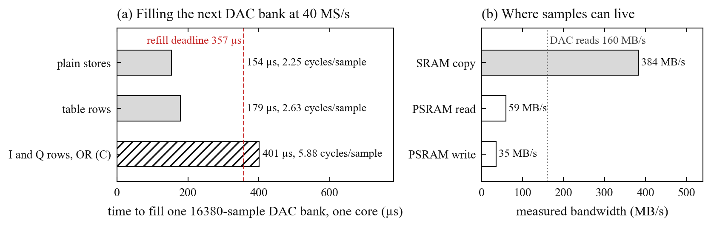
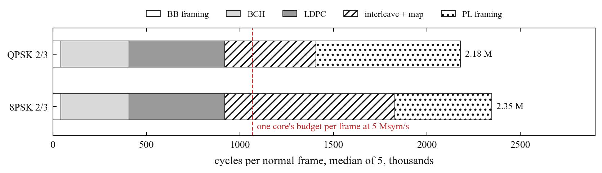

# How it got here

The [README](../README.md) shows where the transmitter stands now. This page is the path to it:
each step, what it measured, and what went wrong on the way. Every number comes from a run in
`results/`, linked at the end of its paragraph. All runs used one ESP32-S3 at 240 MHz.

## 1. The budget

The S3's radio contains a test engine that plays a 16,380-sample bank from internal RAM into
its I/Q DAC at 40 MS/s, looping until the CPU switches it to the other bank. After the overlap
the engine needs, a freshly filled bank is due every 356.7 µs, or 85,608 CPU cycles. Everything
else in this project is measured against that number.

The first benchmark asked whether one core could even write that fast. Copying 8-sample rows
from a precomputed table filled a bank in 179 µs, half the deadline. Building each sample from
separate I and Q tables in plain C took 401 µs and missed. PSRAM read at 59 MB/s against the
160 MB/s the DAC consumes, so samples have to be made in internal RAM, and PSRAM can only hold
payload. ([memory](../results/2026-10-16-memory/README.md))

Payload over the S3's USB port arrived at 4.6 Mb/s: enough for tests, half the 9.68 Mb/s video
mode. ([usb](../results/2026-10-16-usb/README.md))

## 2. A first encoder, exact but slow

The first C encoder was plain bit-level loops. All 140 output CRCs (14 MODCODs, two input
types, five frames each) matched the Python reference. An 8PSK 2/3 frame took 2.35 M cycles,
which covers QPSK at 1 Msym/s with 27% of a core; 8PSK at 5 Msym/s needed it 2.3 times faster.
([encoder](../results/2026-10-16-encoder/README.md))

Meanwhile the Python reference's waveforms went through LeanDVB, an independent receiver:
40 host loopbacks, every payload recovered bit for bit.
([decode](../results/2026-10-16-decode/README.md))

## 3. Pulse shaping at 1.78 cycles per sample

The same idea as the [RP2350 version](https://github.com/Rivercraft911/RP2350_IQ_Benchmark):
precompute every output the shaping filter can produce. A 9-symbol root-raised-cosine pulse is
split into three 3-symbol windows, and each output sample is the sum of three table words plus
one XOR. Plain C took 15 cycles per sample. The S3's 128-bit PIE vector instructions brought
it to 1.78: 121 µs per bank, 34% of a core at 40 MS/s. All 18 board checksums matched the
Python model. ([shaper](../results/2026-10-16-shaper/README.md))

## 4. First RF

The first way of keying the radio, forcing the front end on directly, radiated, but only the
I branch reached the mixer: a test tone came out double-sideband on a carrier leak stronger
than the signal. Starting the vendor's CW test tone, stopping it and moving only the PLL (a
method from esp-sdr-zephyr) brought both branches alive. Pinning the gain afterwards made the
level repeat within 0.5 dB. A +1 MHz tone then showed its image at -35 dBc and the carrier leak
near -45 dBc on an E200 SDR. In 45 keyed runs no bank fill was late: of 1,070,892 switches,
0.3% landed after their nominal time, all inside the overlap that both banks share.
([radio](../results/2026-10-16-radio/README.md))

The same captures found the limits to work around. The chain is linear to a DAC amplitude of
about 128 and turns its own gain down above that, so signals keep their peaks near 128. The
transmit filter appeared to pass about ±10 MHz in this mode, still to be confirmed on a cable.
Not yet explained: an envelope line at 610 Hz (40 MHz / 65,536) and lines ±13 kHz from the tone.

## 5. The whole chain on the chip, radio off

`dvbdump` runs the transmitter exactly as it would transmit, bank switches included, but sends
the samples over USB instead of starting the radio. LeanDVB decoded four QPSK code rates at
three drive levels with zero bit flips, and the 40 MS/s dump measured 47.0 dB MER against the
Python encoder. ([dry run](../results/2026-10-16-dryrun/README.md))

The first 4 MS/s measurement said 35.7 dB, and the write-up blamed aliasing. The measurement was
wrong: its eighth-sample delay grid could not reach the true delay, and it reported the delay
with the wrong sign. With band-limited interpolation the same dump measures 43.8 dB. The
correction sits in the same results file.

## 6. Continuous encoding

The transmitter stopped looping eight frames. Core 0 encodes a non-repeating payload frame by
frame into a ring, and core 1 shapes it into the banks. In 27 minutes of paced runs, 4.5 million
bank fills all met their deadline, and LeanDVB recovered contiguous bit-exact slices of the
stream. When the encoder was slowed on purpose, filler frames kept the stream valid.
([stream](../results/2026-10-16-stream/README.md))

## 7. A fast encoder

The encoder was rewritten with tables, whole-word operations and PIE kernels. An 8PSK 2/3 frame
went from 2.35 M cycles in the first run (2.53 M for the plain path in the new build) to 213k,
20% of a core at 5 Msym/s. A portable C version of the same algorithms takes 0.96 M. The stream's
output did not change by a byte. The board also settled a question QEMU had got wrong: the
silicon computes `EE.LDXQ.32` addresses as the reference manual says, where QEMU was 4 bytes
off. ([fast encoder](../results/2026-10-16-fec-limit/README.md))

## 8. 8PSK in the transmitter

8PSK 2/3 and 5/6 came out of the chip bit-exact at 5 and 10 Msym/s. 5 Msym/s held its
deadlines for 60 s, with 7% slack. 10 Msym/s did not: a bank fill took 98k-112k cycles against
85.6k. Board timing showed where the host model had been optimistic. At 5 Msym/s with the
encoder nearly idle, a fill still took 67.9k cycles, 25% over the model's 54.2k, and the
encoder's memory traffic added up to 11k more. The encoder cost about 700k cycles per frame in
the stream against 213k on the bench, from payload generation and writing frames to PSRAM.
([8PSK on the board](../results/2026-10-16-8psk-board/README.md))

## 9. Correcting for the DAC's hold

A DAC holds each sample for one sample period, which rolls the band edge off by sinc(f/Fs):
-0.41 dB at 10 Msym/s. DVB-S2 (EN 302 307-1, Annex A) asks for an x/sin x correction in exactly
this case, and pre-emphasised taps cost no cycles. After an ideal hold, the 10 Msym/s signal
improves from 37.6 to 41.6 dB MER, and the board's samples agree with the model within 0.02 dB.
The merge also showed why every change is re-measured on the board: a new C kernel had made the
tail path 25% slower, which a same-session baseline caught.
([integration](../results/2026-10-16-integrate/README.md))

## 10. Keyed, in a shielded box

Station identification came first. The firmware refuses to key without a stored callsign,
sends 20 WPM Morse at the start and end of a run and every nine minutes, and puts the callsign
in every frame. ([station ID](../results/2026-10-16-station-id/README.md))

The first keyed attempt stopped before keying with `ESP_ERR_NO_MEM` in Wi-Fi start-up: the
encoder context and station ID had left 8.5 KB of internal RAM. Shrinking Wi-Fi's buffers and
moving its code and allocations out of internal RAM raised idle free RAM from 69.0 to 86.8 KB.
The next run sent 8PSK 2/3 at 5 Msym/s, 9.68 Mb/s, for 30 s inside a lab Faraday box: 84,105
bank fills, none late, smallest slack 6,390 cycles. Nothing received it, so this shows the
transmit path running, not signal quality.
([keyed run](../results/2026-10-16-keyed-box/README.md))

## 11. 10 Msym/s fits

Three changes made the 10 Msym/s fill fit, after a cycle profile of every stage. Frames stay in
internal RAM packed two symbols per byte, so neither core touches PSRAM per symbol. The 2,048
samples both banks share are kept in a cache instead of being shaped twice. At 10 Msym/s the
ring holds three frames. The longest fill fell from 98k-112k to 57k cycles, a third of the
deadline to spare, and the encoder in the stream from about 700k to 257k cycles per frame. The
dumps stayed byte-identical. ([build-out](../results/2026-10-16-buildout/README.md))

A new BCH kernel with an 8 KiB byte table then won on the bench and lost in the stream. It
saved 24k cycles in BCH, and the same 24k reappeared in the framing stages as cache misses: the
encoder's tables and workspace all share a 32 KiB data cache. The smaller register-based kernel
went in instead, taking 8PSK 5/6 from 376k to 291k cycles per frame.
([integration](../results/2026-10-16-next/README.md))

Keyed in the box, 8PSK 2/3 and 5/6 ran at 10 Msym/s, 19.4 and 24.2 Mb/s, for 30 s each with
every deadline met. ([keyed at 10 Msym/s](../results/2026-10-16-keyed-10m/README.md))

## 12. 20 Msym/s

Four engineers then worked in parallel on one brief, the last factor of two.
([fill](../results/2026-10-16-next2/README.md), [20 Msym/s](../results/2026-10-16-20msym/README.md))

- **Fill:** samples already finished in the bank overlap are reused instead of shaped twice,
  and a 554-byte symbol cache that was shifted with ROM's byte-by-byte `memmove` became 10
  bytes. The 4 samples/symbol bank went from 57k to 44k cycles.
- **Encoder:** with its workspace and BCH table moved into internal RAM, flash misses fell to
  zero and an 8PSK 2/3 frame went from 262k to 167k cycles.
- **Bank geometry:** the lead and overlap had been inherited from another project and never
  measured, and the switches that landed late were the 1 kHz OS tick on the fill core. With
  interrupts masked through each switch and a 512-sample overlap at 80 MS/s, a bank is due
  every 47,220 cycles instead of 42,804.
- **26.67 Msym/s:** two new kernels for 3 samples per symbol measured 4.06 and then 2.84 cycles
  per sample. The chip's 26.67 Msym/s samples decode bit-exact, but a whole bank still takes
  46.4k cycles. ([short pulse](../results/2026-10-16-short-board/README.md))

Keyed in the box, 8PSK 2/3 and 5/6 ran at 20 Msym/s from the 80 MS/s DAC, 38.7 and 48.4 Mb/s,
for 30 s each with every deadline met.
([keyed at 20 Msym/s](../results/2026-10-16-keyed-20m/README.md))

## Side roads

- **APSK.** The Python reference does 16APSK and 32APSK, and 56 host loopbacks through LeanDVB
  recovered every file. Not in firmware yet.
  ([APSK decode](../results/2026-10-16-apsk-decode/README.md), [reference encoder](encoder.md))
- **Files over a one-way link.** `host/filelink.py` splits a file into packets with a
  Reed-Solomon erasure code, so any 4 lost frames in 20 still recover the file. Host
  simulation only. ([file link](file-link.md), [run](../results/2026-10-16-filelink/README.md))
- **DMA as the sample engine.** Ruled out. The S3's GDMA moved internal memory at 53-63 MB/s,
  so copying one bank took 250k-306k cycles against the 85.6k deadline, and letting DMA copy the
  bank overlap while the CPU shaped the rest was slower in every case than the CPU alone. The
  CPU with PIE stays the sample engine. ([DMA](../results/2026-10-16-dma-offload/README.md))

## 13. QPSK at 26.67 Msym/s

Four-symbol QPSK tables and a packed ring brought the complete 9/10 stream to
80/3 Msym/s. The radio-off run's worst bank was 39,139 cycles against 47,220;
all samples decoded bit for bit. Keyed in the box for 30 s, every deadline held,
carrying 46.6 Mb/s. This still does not establish receiver decoding over RF.
([radio off](../results/2026-10-17-qpsk-goal/README.md),
[keyed](../results/2026-10-17-keyed-qpsk/README.md))

## Now

The next measurement is a receiver decoding the signal over a cabled RF path.
Payload over SPI and more fill margin remain. The current implementation and
its checks are in [fill](bank-fill.md), [encoder](encoder.md) and
[radio/bank geometry](bank-geometry.md).
