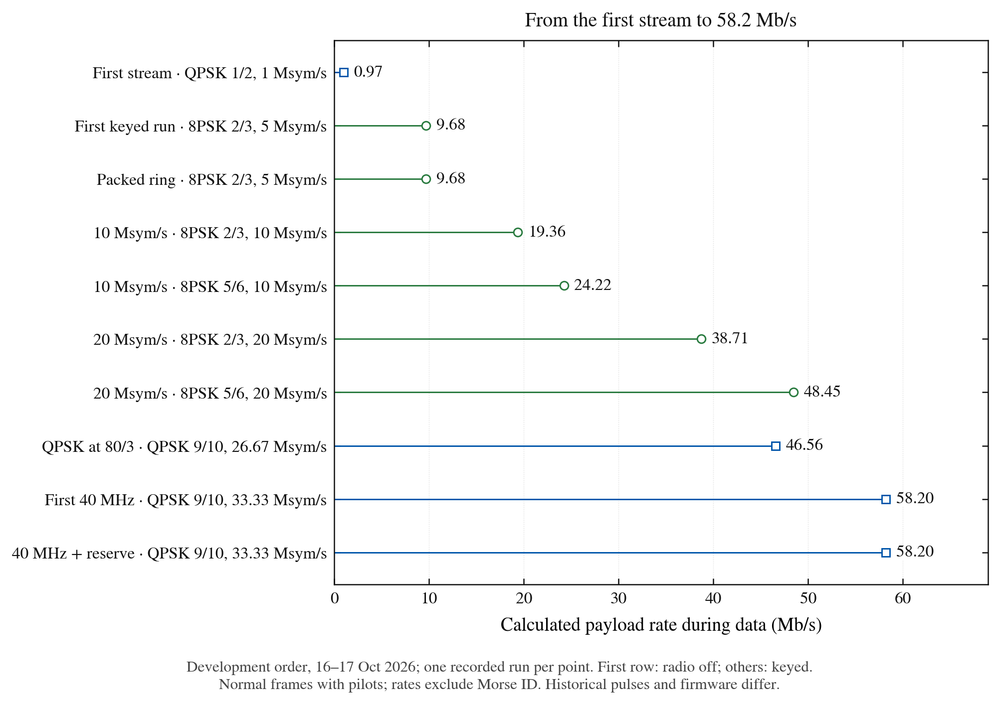
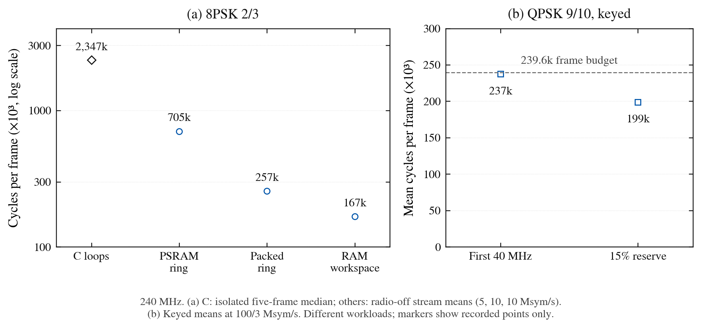
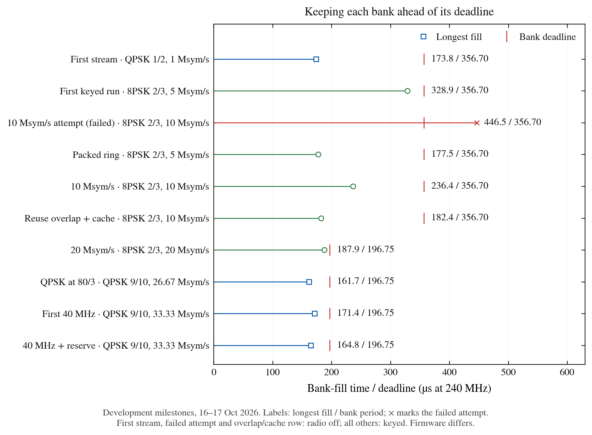
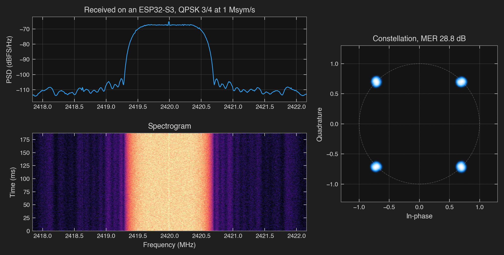

# How it got here

The [README](../README.md) shows where the transceiver stands today: one ESP32-S3 transmits
DVB-S2 at up to 69.8 Mb/s with a payload that never repeats, and a second one receives and
decodes 12.64 Mb/s entirely on the chip, both over coax. This page is the long way round. It is
what I measured, in the order I measured it, and everything that broke along the way.

Three words come up a lot:

- **Keyed**: the S3's radio really transmitted: on the first day through an attenuator into an
  antenna, then into a closed lab Faraday box, later down coax through 30 to 60 dB of attenuation
  into a receiver.
- **Radio off**: the same encoder and bank schedule ran in real time, but the samples went
  nowhere, or over USB into a file.
- **Prepared payload**: one buffer of payload bytes, encoded again for every frame. A
  **changing payload** puts new bytes in every frame.

Every run used ESP32-S3s at 240 MHz. Links into `archive/dev-2026-10-17` point at the
preserved development archive, where the raw records of the first two days live.

The history figures use [recorded points with per-point provenance](measurements/plot-data.json).

## The budget

DVB-S2 ([ETSI EN 302 307-1](https://www.etsi.org/deliver/etsi_en/302300_302399/30230701/01.04.01_60/en_30230701v010401p.pdf))
is the standard behind most satellite TV. It cuts data into frames, protects them with two
error-correcting codes, maps the bits onto QPSK or 8PSK symbols, and adds a header and pilot
symbols so a receiver can find and follow the signal. Doing all of that on a $5 chip starts
with one blunt question: can it even make samples fast enough?

The S3's radio hides a test engine, which [esp-sdr-zephyr](prior-art.md) turned into a
transmitter. It plays a bank of 16,380 samples from internal RAM into the I/Q DAC, looping until
the CPU hands it the other bank. At 40 MS/s, after the overlap the engine needs, a freshly filled
bank is due every 356.7 µs, or 85,608 CPU cycles. Everything else in this project is measured
against that number.

The first benchmark gave the answer. Copying 8-sample rows from a precomputed table filled a
bank in 179 µs, half the deadline. Building each sample from separate I and Q tables in plain C
took 401 µs and missed. PSRAM, the 8 MB external RAM, read at 59 MB/s while the DAC consumes
160 MB/s, so samples have to be made in internal RAM.
([memory](https://github.com/Rivercraft911/esp-dvbs2/blob/archive/dev-2026-10-17/results/2026-10-16-memory/README.md))

## Coding and shaping

A MODCOD names a modulation and code rate pair, such as 8PSK 2/3: three bits per symbol, two of
every three coded bits carrying data. The codes are an outer BCH code and an inner LDPC
(low-density parity-check) code, 64,800 bits per normal frame.

The first C encoder was plain bit-level loops. All 140 output CRCs (14 MODCODs, two input types,
five frames each) matched the Python reference. A QPSK 1/2 frame took 2.27 M cycles, 28% of one
core at 1 Msym/s. An 8PSK 2/3 frame took 2.35 M, which at 5 Msym/s is 221% of a core: it had
to get 2.3 times faster before 8PSK video was even on the table.
([encoder](https://github.com/Rivercraft911/esp-dvbs2/blob/archive/dev-2026-10-17/results/2026-10-16-encoder/README.md))

Meanwhile the Python reference's waveforms went through LeanDVB, an independent open-source
receiver: 40 host loopbacks, every payload bit recovered.
([decode](https://github.com/Rivercraft911/esp-dvbs2/blob/archive/dev-2026-10-17/results/2026-10-16-decode/README.md))

Pulse shaping borrowed the trick from my
[RP2350 version](https://github.com/Rivercraft911/RP2350_IQ_Benchmark/tree/88ab018e65a51805ff562842177a4d47b1b04b2e):
precompute every output the shaping filter can produce. A 9-symbol root-raised-cosine pulse
splits into three 3-symbol windows, so each output sample is the sum of three table words plus
one XOR. Plain C took 14.97 cycles per sample. PIE, the S3's Processor Instruction Extensions
(128-bit vector instructions), brought it to 1.776: 121 µs per bank, 34% of a core at 40 MS/s.
All 18 board checksums matched the Python model.
([shaper](https://github.com/Rivercraft911/esp-dvbs2/blob/archive/dev-2026-10-17/results/2026-10-16-shaper/README.md))

## First RF, in mono

The first way of keying the radio, forcing the front end on directly, radiated. That is where
the good news ended: only the I branch reached the mixer. A Q-only test signal produced no
sidebands at all, and a +1 MHz tone came out double-sideband, sitting on a carrier leak stronger
than the signal itself.

The fix came from esp-sdr-zephyr: start the vendor's CW test tone, stop it, and move only the
PLL. That brings the transmit chain up with the PHY's calibrated settings, both branches alive.
Pinning the gain afterwards made the level repeat within 0.5 dB over three keyings. The +1 MHz
tone then showed its image at -35 dBc and the carrier leak near -45 dBc (dBc: decibels relative
to the wanted tone), received by an E200 SDR on a 433 MHz whip, very much the wrong antenna for
2.4 GHz.

Timing held from the start. In 45 keyed runs, 1,070,892 bank switches produced no late fill;
0.3% of switches landed after their nominal time, all inside the overlap both banks share.
([radio](https://github.com/Rivercraft911/esp-dvbs2/blob/archive/dev-2026-10-17/results/2026-10-16-radio/README.md))

## The whole chain, radio off

`dvbdump` runs the transmitter exactly as it would transmit, bank switches included, but sends
the samples over USB instead of starting the radio. LeanDVB decoded four QPSK code rates and
three drive levels with zero bit flips. Against the Python encoder, the 40 MS/s dump measured
47.0 dB MER (modulation error ratio: the power of the ideal symbols over the mean power of the
error between each received symbol and its ideal point).
([dry run](https://github.com/Rivercraft911/esp-dvbs2/blob/archive/dev-2026-10-17/results/2026-10-16-dryrun/README.md))

Then the transmitter stopped looping eight canned frames. Core 0 encodes a non-repeating payload
frame by frame into a ring, and core 1 shapes it into the banks. In 27 minutes of paced runs,
4.5 million bank fills all met their deadline, and LeanDVB recovered contiguous bit-exact slices
of the stream. With the encoder slowed down on purpose, filler frames kept the stream valid.
([stream](https://github.com/Rivercraft911/esp-dvbs2/blob/archive/dev-2026-10-17/results/2026-10-16-stream/README.md))

## Keyed, in a shielded box

Station identification came first. The firmware refuses to key without a stored callsign, sends
20 WPM Morse at the start and end of a run and every nine minutes, and puts the callsign in every
synthetic test frame.
([station ID](https://github.com/Rivercraft911/esp-dvbs2/blob/archive/dev-2026-10-17/results/2026-10-16-station-id/README.md))

The first keyed attempt never keyed: `ESP_ERR_NO_MEM` during Wi-Fi start-up, with 8,574 bytes of
internal RAM left. Shrinking Wi-Fi's buffers and moving its code and allocations out of internal
RAM raised idle free RAM from 69.0 to 86.8 KB. The next run sent 8PSK 2/3 at 5 Msym/s, 9.68 Mb/s,
for 30 s inside the Faraday box: 84,105 bank fills, none late, smallest slack 6,390 cycles.
Nothing received it, so this proved the transmit path kept time, not that the signal was any good.
The same holds for every keyed box run in the next five sections, until the E200 joined the box.
([keyed run](https://github.com/Rivercraft911/esp-dvbs2/blob/archive/dev-2026-10-17/results/2026-10-16-keyed-box/README.md))

## 10 Msym/s

Doubling the symbol rate broke the fill. At 10 Msym/s the longest bank fill took 107k to 114k
cycles against the 85,608-cycle deadline, and the run stopped after two late fills. The profile
showed why: with frames in PSRAM, both cores kept missing in the shared data cache, and one 8PSK
2/3 frame spent 150k cycles on baseband framing and 227k on mapping.

Three changes fixed it. Frames moved to internal RAM, packed two symbols per byte. A 554-byte
cache kept the symbols the bank overlap needs. The ring held three frames at 10 Msym/s. The
longest fill fell to 57k cycles, a third of the deadline to spare, and an 8PSK 2/3 frame went
from 705k to 257k cycles. Every dumped sample stayed byte-identical.
([build-out](https://github.com/Rivercraft911/esp-dvbs2/blob/archive/dev-2026-10-17/results/2026-10-16-buildout/README.md))

Keyed in the box, 8PSK 2/3 and 5/6 ran at 10 Msym/s, 19.4 and 24.2 Mb/s, for 30 s each with
every deadline met.
([keyed at 10 Msym/s](https://github.com/Rivercraft911/esp-dvbs2/blob/archive/dev-2026-10-17/results/2026-10-16-keyed-10m/README.md))

## 20 Msym/s

The last factor of two needed changes to the fill, the encoder and the bank schedule.
([fill and encoder](https://github.com/Rivercraft911/esp-dvbs2/blob/archive/dev-2026-10-17/results/2026-10-16-next2/README.md),
[20 Msym/s](https://github.com/Rivercraft911/esp-dvbs2/blob/archive/dev-2026-10-17/results/2026-10-16-20msym/README.md))

- **Fill:** samples already finished in the bank overlap are reused instead of shaped twice, and
  the 554-byte symbol cache, shifted with ROM's byte-by-byte `memmove`, became 10 bytes. A bank at
  4 samples per symbol went from 57k to 44k cycles.
- **Encoder:** with its workspace and BCH table moved into internal RAM, flash misses fell to
  zero and an 8PSK 2/3 frame went from 262k to 167k cycles.
- **Bank geometry:** the lead and overlap came from esp-sdr-zephyr's sleep-based scheduler and
  had never been measured here. The 0.3% of late switches turned out to be the 1 kHz FreeRTOS
  tick on the fill core. With interrupts masked through each switch and a 512-sample overlap at
  80 MS/s, a bank is due every 47,220 cycles instead of 42,804.

Keyed in the box, 8PSK 2/3 and 5/6 ran at 20 Msym/s from the 80 MS/s DAC, 38.7 and 48.4 Mb/s,
for 30 s each with every deadline met. The tightest fill left 1,842 cycles to spare: 7.7 µs.
([keyed at 20 Msym/s](https://github.com/Rivercraft911/esp-dvbs2/blob/archive/dev-2026-10-17/results/2026-10-16-keyed-20m/README.md))

## QPSK at 26.67 Msym/s

A packed QPSK ring and a new 3-samples-per-symbol fill took QPSK 9/10 to 80/3 Msym/s. The
radio-off run's worst bank took 39,139 of 47,220 cycles, and every dumped sample decoded bit for
bit. Keyed in the box for 30 s, every deadline held while carrying 46.6 Mb/s in 36 MHz. The
encoder's slowest frame, 524k cycles with Wi-Fi active against a 299,538-cycle frame, vanished
into a lead of 32,155 queued symbols.
([radio off](https://github.com/Rivercraft911/esp-dvbs2/blob/archive/dev-2026-10-17/results/2026-10-17-qpsk-goal/README.md),
[keyed](https://github.com/Rivercraft911/esp-dvbs2/blob/archive/dev-2026-10-17/results/2026-10-17-keyed-qpsk/README.md))

## 40 MHz

The moonshot was the S3's widest Wi-Fi channel: 40 MHz occupied, QPSK at 100/3 Msym/s, roll-off
0.20, 2.4 samples per symbol. It took twelve rounds across six branches. A fill helper on the
second core kept fighting the encoder. A queue of precomputed table offsets rendered banks fast
but cost core 0 too much. The winner, **sign windows**, treats QPSK's I and Q as two BPSK
streams: each four-sample output vector depends on eight signs per axis, so it comes from small
sign-indexed tables and one OR.

Keyed in the box, QPSK 9/10 at 100/3 Msym/s ran for 30 s, 58.2 Mb/s during data, with no late
fill and no underrun. It worked, barely: the encoder used 99% of each frame.
([40 MHz](https://github.com/Rivercraft911/esp-dvbs2/blob/archive/dev-2026-10-17/results/2026-10-17-moonshot/README.md))

The margin came the same day. The encoder now queues compact I/Q bit planes, core 1 pulls the
sign windows straight out of them while rendering, and the encoder wakes once per bank instead of
once per page. Keyed again, the encoder averaged 198,879 of 239,630 cycles per frame (17% spare,
up from 1%) and the longest fill took 39,548 of 47,220 cycles (16% spare). That is the 15%
reserve I wanted, on both cores. ([record](measurements.md#40-mhz))

The next morning brought a twist. Keyed runs had always looked about 47k cycles per frame slower
than radio-off paces, and I had blamed the radio. The radio was innocent. Keyed `dvb` runs
generated fresh pseudo-random payload for every frame, while paces copied a prepared one. Given
the same prepared payload, keyed and radio-off runs agreed: 150,667 against 152,754 cycles per
frame, 37% encoder headroom. Live input at this rate is still unqualified.

The same records gave PHY-solo its first outing: deinitializing Wi-Fi while keeping the PHY
powered changed the keyed encoder mean by two cycles and handed back 15,304 bytes of internal RAM
during playback. It returns later in this story with a much better reason to exist.
([records](measurements.md#40-mhz))

## 8PSK at 36 MHz

The next step was 8PSK at 26.67 Msym/s: three bits per symbol promised more data than QPSK's
40 MHz mode, in a narrower 36 MHz channel. It began with a cache storm. The encoder's flash
tables and the renderer kept evicting each other's working sets. Resident tables in internal RAM
and compact queued descriptors made the encoder fast enough, and standard dummy frames gave a
late encoder somewhere to recover without breaking the data sequence.

The fastest encoder still lost airtime to dummies, though the models said it should keep up. A
sweep of the queue depth found what was missing. At 46 pages it inserted 17,602 steady dummies of
3,330 symbols in 10 s, 22% of the airtime; at 50 pages, 5,180; at 54, none. A data frame needs 44
pages, and ten spare pages let the next frame's burst of mapping overlap playback. The queue
depth, not the mean encoder time, set the limit. Sharing the table store and moving cold data to
PSRAM made 54 pages fit with Wi-Fi running.
([page sweep](measurements/2026-10-18-8psk-page-sweep.jsonl))

Keyed in the closed box for 30 s each, all three rates ran without a late fill or a steady
dummy: 51.6 Mb/s at 2/3, 64.6 at 5/6 and **69.8 at 9/10**. The longest bank fills were 39,419,
38,803 and 38,963 cycles against 47,220. 9/10 kept 20.5% encoder spare and meets the 15% reserve
on both cores; 2/3 and 5/6 run at full rate with 14% and 12%. These runs used a prepared payload,
and their samples had only been decoded from USB dumps. RF came later.
([keyed records](measurements.md#8psk-at-36-mhz))

## Over the air

The E200 finally went into the closed Faraday box with the S3, receive only, running Pluto
firmware. At 2420 MHz, QPSK 1/2 at 1 Msym/s came back as 587 frames, every payload byte matching
the host model, at 16.7 dB MER (LeanDVB's header MER). QPSK 3/4 at 5 Msym/s followed with 1,436
frames, then a 124-frame burst at 10 Msym/s with zero LDPC flips. The samples had made it through
the radio. ([runs](measurements.md#over-the-air))

At 80 MS/s, turning it up made it worse. QPSK 9/10 at 20 Msym/s would not decode at peak 128,
even though the chip's samples were correct: the radio was being overdriven. (Peak is the
largest sample magnitude the pulse table allows, out of 511.) Peaks 32 to 64 decoded, and 48 was
best, at 14.2 dB MER, a figure from the operator's run summary whose raw report was not kept.
The digital tests had never exercised that non-linearity.

VCM (variable coding and modulation, a different MODCOD in each frame) made it through too:
2,938 frames switching QPSK code rates at 5 Msym/s, then 3,517 frames and 21 MB switching between
QPSK and 8PSK every frame. The laptop then changed code rates mid-transmission over USB, and a
237 KB PNG crossed with a matching SHA-256, erasure-coded so that one frame per 20-frame block
could be dropped on purpose and still come back. ([VCM](vcm.md), [file transfer](file-link.md))

Then a ±30 MHz chirp, received with the E200 tuned to 2405, 2420 and 2435 MHz and stitched from
the middle of each capture, exposed the S3's transmit filter: about 20 MHz wide, down 3 dB at
±10 MHz and about 20 dB by ±14 MHz. The 36 and 40 MHz modes met every deadline and generated
correct samples, and the filter cut their edges clean off. Through that filter, neither decoded
over the air.

## The wide filter

Somewhere along the way the $5 chip outgrew the SDR on the bench: the E200's AD9363 sees at most
20 MHz. A B200 joined the bench, fed by coax through 40 dB of attenuation.

Experimental firmware restored the radio's wide analog-filter setting, PBUS(4,2)=32, after the
test-tone setup reset it. The B200 captured a whole 40 MHz channel in one 83.886 ms burst at
50 MS/s, and a private soft-LDPC receiver recovered 81 consecutive exact QPSK 3/4 frames from it,
489,321 payload bytes. ([wideband experiments](measurements.md#wideband-experiments))

On main the fix is one register and a readback. The CW bring-up resets PBUS(4,2), and the
digital bandwidth call, the one earlier records read back as wide, leaves it unchanged
([fix](https://github.com/Rivercraft911/esp-dvbs2/commit/4209d1caf2ee86b48565831bce9d30d79fbe28ba)). Before the fix, main's wide fixtures decoded zero frames. After it, stock LeanDVB recovered exact
payloads from single 41.94 ms B200 captures in every 36 and 40 MHz mode: 47 frames of 8PSK 9/10
in 36 MHz (69.8 Mb/s) and 40 of QPSK 9/10 in 40 MHz (58.2 Mb/s), both with prepared, repeated
payloads, plus changing payloads at 20 and 26.67 Msym/s.
([wide filter](../results/2026-10-20-wide-filter/README.md))

QPSK at 26.67 Msym/s still reported two transmitter underruns per run: its two-slot ring ran dry
on the first refill after the opening station ID. A third slot, 8,352 bytes, fixed it. Three 20 s
runs had zero underruns and gave 32, 31 and 32 exact frames in their captures.
([startup](../results/2026-10-20-qpsk-startup/README.md))

8PSK 9/10 at 26.67 Msym/s, 69.8 Mb/s during data: one 41.94 ms B200 capture with 47 exact
frames, from a prepared, repeated payload. These short captures prove exact payload recovery,
not sustained wideband video. [Capture and plotting details](../results/2026-10-21-rf-figures/README.md).

## Live video from a CM5

On October 19 the transmitter carried real pictures. A CM5 sent two camera streams as a 9 Mb/s
MPEG transport stream (TS: the 188-byte packets broadcast video travels in) over 16 MHz SPI to a
XIAO S3. The S3 sent 8PSK 2/3 at 5 Msym/s, 9.68 Mb/s of capacity in 6.75 MHz. A B200 behind 40 dB
of coax attenuation, at 20 dB of receive gain, fed LeanDVB, which recovered both streams with no
TS continuity gaps in a 111 s interval. A completed 140 s run accepted 106,227 SPI messages with
no protocol errors and no late bank events. ([live RF](../results/2026-10-19-live-rf/README.md),
[example](../examples/live-video/README.md))

Not every run was that clean. With 60 dB of attenuation and 40 dB of receive gain, the same setup
had 18 TS gaps in 112 s. These runs also used a carrier-leak correction measured on that one
board. Conducted runs say nothing about range.

## Up and down the band

The S3's PLL tunes far outside the Wi-Fi channels. Conducted into a B200 through 40 dB of
attenuation, changing payloads decoded exactly at seven carriers from 2025 to 2420 MHz, in QPSK
1/2 at 1 Msym/s and QPSK 3/4 and 8PSK 2/3 at 5 Msym/s. Thirty-second captures returned 6,754
8PSK frames at both 2025 and 2067 MHz, 9.672 Mb/s. Repeats at 2200 and 2290 MHz returned 6,755
consecutive exact packets each, 36,274,350 payload bytes per run.
([S-band](../results/2026-10-20-s-band/README.md),
[repeats](../results/2026-10-20-s-band-repeat/README.md))

At the bottom edge, 2000 MHz needed the radio's five-sixths divider, with the PLL running at
six-fifths of the RF frequency. QPSK 3/4 at 5 Msym/s passed 30 s there with 4,505 consecutive
exact packets. ([lower edge](../results/2026-10-20-band-followup/README.md))

Two sustained attempts failed, and they stay failed in the records: QPSK at 2025 MHz with 40 dB
of receive gain, and 8PSK at 2245 MHz after 461 exact frames. A private soft-FEC prototype later
passed 30 s of 8PSK at 2245 MHz; why the stock decoder lost lock is still unresolved
([soft FEC](../results/2026-10-20-band-followup/README.md)).

## Short frames

For the receiver I wanted smaller frames. A short FECFRAME (the coded block BCH and LDPC work on)
is 16,200 bits instead of 64,800, and the FEC context at QPSK 3/4 drops from 16,832 to 5,312
bytes. QPSK short frames, MODCODs 4 to 10, went in bit exact against the Python model, in both C
paths, on the board and in decoded waveforms.
([short frames](../results/2026-10-22-short-frames/README.md))

LeanDVB then reported about 292 LDPC bit flips per frame on perfectly clean short 3/4 samples.
The bug was in the receiver. Its `ldpc_sf_fec34` table lists 12 addresses in the first row but
sets `ncols` to 3. With 12, the same dump decodes with zero flips. My table row matches the
standard and GNU Radio's gr-dtv. Later short-frame decodes use that one-line fix.

Over RF the B200 and LeanDVB delivered between 2,764 of 3,552 and 3,389 of 3,575 short frames
(78% to 95%), every delivered frame exact; a normal-frame control in the same setup delivered
64%. Many failed attempts in the receiver log were wrong-MODCOD header guesses, so the losses
look like lost lock, not payload errors.

## The receiver

Everything so far needed an SDR and a laptop to prove it. The question that had been sitting
there all week: can an S3 receive what an S3 sends?

The S3 can capture its radio's samples through the same undocumented dump engine that plays the
transmitter's banks. [ESPARGOS](prior-art.md) showed raw I/Q capture from these chips, and
esp-sdr-zephyr's register notes map the engine on the S3. Receiving is a much
harder budget, though. The transmitter only has to produce samples on time. The receiver has to
find frames in noise, follow timing and carrier, and decode, all before the next 768 µs of
samples lands: 12,288 samples at 16 MS/s, 184,320 cycles.

### A finite first try

On October 21 an earlier receiver, now kept at
[archive/exp/s3-receive](https://github.com/Rivercraft911/esp-dvbs2/tree/archive/exp/s3-receive),
proved the pieces. One S3 sent QPSK 1/2 normal frames at 1 Msym/s through 30 dB into another.
The receiving S3 collected 400 ms, stopped, and decoded its first two packets: all 8,032 payload
bytes matched at 2110, 2245 and 2420 MHz. A separate quiet run collected and matched-filtered
31.46 s with no gaps. But decoding the second frame took 160.853 ms against a 33.282 ms frame
interval, almost five times too slow to keep up.
([receiver experiments](measurements.md#receiver-experiments))

### The plan

For a continuous receiver I set a modest first goal: short-frame QPSK 3/4 at 1 Msym/s, 1.39 Mb/s,
every frame exact, decoded on the chip. A frame lasts 8.37 ms, 2,008,800 cycles per core. Core 1
turns radio samples into symbols: capture, unpack, a matched filter evaluated only at symbol
times, and timing and carrier tracking from the header and pilots. Core 0 turns symbols into
bits and checks each frame.

The check is the trick. Core 0 does not decode first. It re-encodes the hard decisions with the
transmitter's own fast BCH and LDPC encoder and compares parity, 31.6k cycles at QPSK 3/4. Only
frames that fail go to the full LDPC decoder, a layered normalized min-sum in int8 that handles
16 parity checks per PIE vector. ([receiver chain](receiver.md))

### The demodulator

The demodulator was built against real dumps first. On the S3's own short-frame captures it got
22 of 22 and 21 of 21 frames exact, and 98 of 100 normal frames. PIE kernels took its worst
12,288-sample unit from 418,800 to 127,497 cycles. Two findings made it better than I expected:

- The transmitter's carrier leak sits about 17 dB below its own signal. Removing it after
  derotation raised MER from about 16 dB to about 29 dB ([receiving](receiver.md)).
  On most unclipped captures the demodulator measured 26 to 31 dB, where LeanDVB, which does
  not remove the leak, reported 7 to 16 dB.
- Both radios run from 40 MHz crystals, so the symbol clock offset equals the carrier offset
  divided by the carrier frequency, as esp-sdr-zephyr's QAM receiver also assumes. A float fit
  here agreed within 0.01 ppm on 13 of 15 captures. The timing loop starts at that clock and
  only has to hold it.

A digital twin with the measured impairments decoded 3,583 of 3,583 frames at 18 dB, with
0.22 dB of implementation loss against a float reference receiver.
([demodulator](../results/2026-10-22-rx-demod/README.md))

### First light

On October 22 the receiving S3 decoded 30.0 s of capture: 3,583 consecutive frames, every one
byte exact, 5,209,682 payload bytes at 1.390 Mb/s. Goal met, first run.

Run 2 faulted. So did runs 3 and 4, each after three units, still acquiring. Acquisition cost
about 238k cycles per 184k-cycle unit, and three slow units in a row emptied the bank handoff's
slack. Run 5 decoded 3,541 frames exactly, then faulted the moment the closing Morse ID began.
Tracked frames never faulted. The search did.
([first receive](../results/2026-10-22-rx-first/README.md))

### Stacks in the slow lane

The search was expensive, and it was running in the wrong place. After Wi-Fi started, the largest
free block of internal RAM was 3,584 bytes, so the heap quietly gave the capture task's 4 KB stack
a home in RTC FAST memory. The search's C sign loop, which loads and spills through that stack, ran
at 11.5 cycles per word live against 3.35 in replay. The receiver had been doing its hardest work
in the slow lane.

Static stacks in internal RAM fixed the lane. A PIE kernel that forms 64 signs in 408 cycles (the
C version took 2,215) fixed the search, and a search that restarts at the newest samples instead
of catching up fixed the worst case. On noise the worst unit fell to 74,772 cycles.
([acquisition](../results/2026-10-22-rx-demod/README.md#acquisition-on-noise-a-tone-and-dropped-units))

Then the qualification: three 38.3 s runs, with the receiver listening 2 s before the transmitter
keyed. 4,581, 4,578 and 4,577 frames, every one exact, none missing, no capture unit dropped.
([qualification](../results/2026-10-22-rx-continuous/README.md))

QPSK 3/4 at 1 Msym/s, captured by the receiving S3 through its own radio (with the final receiver
firmware) and drawn from its own demodulator's output: 21 of 21 frames exact, data MER 28.8 dB.
[Capture details](../results/2026-10-23-rx-figures/README.md).

### Without Wi-Fi

The receiver still kept Wi-Fi running, for one reason: stop Wi-Fi and the dump froze. Every
sample came back as the same constant. Wi-Fi up meant its interrupts, its periodic work, and
internal RAM so tight that the heap's low point in the qualification runs was 6,128 bytes.

A diff of the radio registers with Wi-Fi up and with it stopped found the culprit. Stopping Wi-Fi
clears bit 1 of `SYSCON_WIFI_BB_CFG_REG`, and the dump needs it. Now Wi-Fi starts only to power
and calibrate the PHY. The receiver holds the PHY through the Bluetooth modem bit, as the
transmitter's PHY-solo mode does, deinitializes Wi-Fi and sets the bit again. Free internal RAM
during a run went from 58 KB to 101 KB
([commit](https://github.com/Rivercraft911/esp-dvbs2/commit/82cf1ad8fec5c5dd78a43d6ea80d73b05a803900)),
and no Wi-Fi interrupt runs during a capture. ([capture](receiver.md))

### The rare bad frame

Even with every qualification run exact, the longer stability runs turned up a handful of
failures: about 6 failed frames in 141k, 4.3 per 100,000. In one set of ten runs both failures
came from the same model frame, 3,226, in two different runs: 14 and 15 wrong bits in four
clusters about 45 symbols apart, roughly 140 µs of disturbed signal around 27 s into the data. A
host build of the same C encoder reproduced the correct codeword, so the encoder was cleared.

The receiver had lost its Wi-Fi; the transmitter still had its own. With the transmitter in
PHY-solo mode, 20 runs delivered 103,453 consecutive frames with none failed or missing. At the
old rate, zero failures in that many frames happens by chance about 1% of the time. Which part
of Wi-Fi caused it is still unknown. ([PHY-solo](../results/2026-10-23-tx-phy-solo/README.md))

### 5 Msym/s and 8PSK

1.39 Mb/s was the goal. Video wanted more.

The transmitter gained short 8PSK frames at 5 Msym/s
([short frames at 5 Msym/s](../results/2026-10-23-short-5m/README.md)). 8PSK 8/9 carries 1,769
payload bytes in 5,598 symbols, so at 5 Msym/s it moves 8 × 1,769 bits every 1.1196 ms,
12.64 Mb/s. On the receiver, the matched filter runs at 3.2 samples per symbol with 32 taps, five
symbols sharing each 16-sample window, at 15.6 to 16.3 cycles per symbol. At 12.64 Mb/s the
payload no longer fits through the S3's full-speed USB port (12 Mb/s signalling), so the receiver
sends each frame's CRC-32 and the host compares it with the model.

The first 5 Msym/s runs passed: 34,256, 34,249 and 34,220 consecutive frames over 38.3 s each,
every CRC-32 equal to the transmitter's, 9.1 times the first goal. One early check had reported a
wrong frame. It was not wrong. Two of the 53,700 model frames share a CRC-32, and the checker,
which looked frames up by CRC, picked the twin. (For 53,700 random 32-bit values about 0.34
colliding pairs are expected, so this was roughly a 29% chance.) The checker now compares each
frame with the model frame its sequence number implies.
([5 Msym/s](../results/2026-10-23-rx-5m/README.md))

Those runs still dropped about 259 capture units, 0.2 s of samples, before every lock. At
5 Msym/s the search was the most expensive state, and it lost to the clock while hunting through
noise and the Morse ID.

### The fold and the eight signs

Two fixes took it to zero drops and better MER.

The first was free. A 3-tap equalizer fitted to real 5 Msym/s symbols found -0.034 to -0.037 at
±1 symbol, real, symmetric and stable to 0.001 across frames and captures: the analog filters
smear each symbol of a 6.75 MHz signal slightly into its neighbours. Folding a 0.035 correction
into the matched-filter coefficients costs nothing per symbol. Data MER on five recorded dumps
rose by 4 to 5 dB, from 23.2-24.3 dB to 27.2-29.1 dB.

The second was a stricter prefilter. At 5 Msym/s the search has a candidate every 1.6 samples,
five times as many per sample as at 1 Msym/s, and each one first had to match the 3 newest
differential signs of the frame header. The Morse ID is a tone, and a tone gives the same
differential sign throughout. MODCOD 16's newest three header terms happen to be equal. So during
the ID every candidate passed, and the search burned 247k cycles per 184k-cycle unit. Asking for
8 signs ended that. The search also builds its sums 320 at a time without divisions and covers
4,096 of every 16,384 samples; on noise it now averages 59k cycles per unit.

The result: three 38.3 s runs of 8PSK 8/9, 34,232, 34,199 and 34,196 frames, every CRC-32 exact,
**12.64 Mb/s with no capture unit dropped** at any point, median pilot MER 29.9 dB (lowest
26.8 dB). QPSK 3/4 at 5 Msym/s (22,892 frames, 6.95 Mb/s) and at 1 Msym/s (4,576 frames) were
exact too. No frame failed the re-encode check, so the LDPC decoder never ran.
([5 Msym/s with margin](../results/2026-10-23-rx-5m-margin/README.md))

8PSK 8/9 at 5 Msym/s, 12.64 Mb/s: 164 of 164 frames exact in this 187.5 ms capture by the
receiving S3, data MER 28.9 dB. [Capture details](../results/2026-10-23-rx-figures/README.md).

Core 1 now spends 120.8k of the 184,320 cycles in each unit. On core 0, turning symbols into bits
takes about 30% and the re-encode check about 24%.

The shares cover whole 45 s receive runs, including the time before keying and the Morse IDs.
[Records](../results/2026-10-23-rx-5m-margin/README.md).

## Fresh payloads, and no Wi-Fi

The fastest transmit rates so far had a catch: they used a prepared payload. A budget of every
mode on the board, with the real xorshift payload, made the catch plain. Copying a stored payload
costs 3k to 6k cycles a frame, generating one 30k to 54k, and with the real payload 8PSK at
26.67 Msym/s missed its frame budget by 1.8 to 10.1%
([budget](../results/2026-10-23-tx-budget/README.md)).

So the encoder got the receiver's treatment, measured stage by stage. xorshift went four lanes per
PIE vector, the t = 10 BCH step dropped from 17 to 14 instructions per byte pair, the LDPC parity
pack was unrolled, and the stage marks stopped copying 32-byte records through 39 ROM `memcpy`
calls. 8PSK at 26.67 Msym/s went from 1.8 to 9.8% spare to 16.5 to 21.3%, radio off
([8PSK](../results/2026-10-23-tx-8psk/README.md)). 8PSK 9/10 at 20 Msym/s turned out to be waiting
on flash: its 8 KiB of BCH pair tables pushed the encoder's tables past the 32 KiB data cache, 310
misses a frame. In internal RAM it went from 254k to 124k cycles a frame
([20 Msym/s](../results/2026-10-23-tx-8psk-20m/README.md)).

Then 19 selected transmitter configurations went back on air with a payload that never repeats,
keyed into a B200: 10,219 frames recovered from sampled bursts, every one exact, 0.97 to
69.8 Mb/s. Along the way it turned out that
that day's earlier B200 captures had used its RX2 port, which hears the signal only by leakage,
about 19 dB down; the table moved the coax to TX/RX ([keyed table](../results/2026-10-23-tx-table/README.md),
[8PSK re-key](../results/2026-10-23-tx-table-8psk-rekey/README.md)).

Wi-Fi left both apps. Each now powers the PHY at boot under the Bluetooth modem bit, the way a
Bluetooth-only app would, and links no Wi-Fi code: the transmitter image went from 939 to 544 KB
and the receiver's from 854 to 447 KB. After boot neither touches the heap; every run takes its
buffers from regions fixed at link or boot time and hands them to the next
([transmitter](../results/2026-10-23-tx-run-memory/README.md),
[receiver](../results/2026-10-23-rx-no-wifi/README.md)).

Taking Wi-Fi out of the receiver turned up two failed frames, and for a moment Wi-Fi looked
guilty. A diff of 3,039 radio registers said the radio was in the same state either way. The
culprit was the receiver. At 5 Msym/s the matched filter plans each batch from times in
1/32 sample held in 32 bits, which wrap every 2^27 samples, 8.39 s, and a batch that straddled a
wrap used the wrong coefficients for about 252 symbols. With the plan in 64 bits, 441,550 frames
decoded with none failed ([Wi-Fi A/B](../results/2026-10-23-rx-no-wifi-ab/README.md)).

Meanwhile the receiver learned MPEG transport stream. It deframes the packets on the chip and
checks every one: 1,738,344 packets crossed the S3 link exact, and with the transmitter starved
of input it rode through 95,810 dummy frames without losing lock
([TS link](../results/2026-10-23-ts-link/README.md)). A sweep of all 19 short-frame modes the
transmitter sends then decoded 223,153 frames, every one exact
([sweep](../results/2026-10-23-rx-sweep/README.md)).

## Now

One S3 has keyed 19 selected configurations with a payload that never repeats, from 0.97 Mb/s to
69.8 Mb/s in 36 MHz and 58.2 Mb/s in 40 MHz, every frame recovered from sampled B200 bursts
exact. It carried a CM5's live
camera mux at 9 Mb/s. A second S3 receives every short-frame mode the first one sends, up to
12.64 Mb/s, and decodes every frame itself. The limits are plain: conducted paths, one pair of
boards, the receiver at 2420 MHz and one gain setting, and no real input has yet fed the top
transmit rates live; quad SPI was tested to 46.6 Mb/s.

Next: live video from one S3 to the other, over Ethernet at both ends. The current
[implementation](how-it-works.md) and [evidence](measurements.md) are the starting point. All
development records remain in the
[archive tag](https://github.com/Rivercraft911/esp-dvbs2/tree/archive/dev-2026-10-17).
